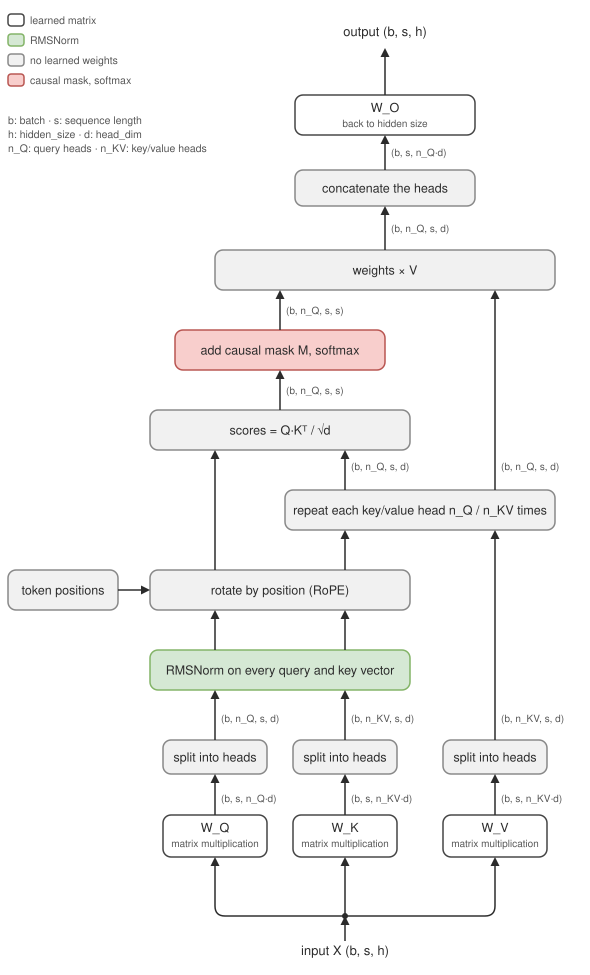
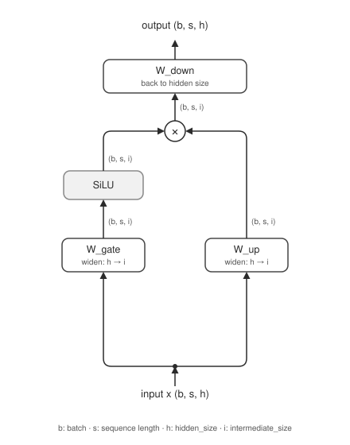

# Anatomy of Qwen3-4B {#sec-anatomy}

**You will learn:**

- where a modern language model's layout comes from, and what it keeps and drops from the original transformer;
- what one layer of Qwen3-4B contains, and how big each part is;
- which of its linear layers LoRA will adapt in a later chapter.

@sec-tokens treated the 36 transformer layers as a black box. This chapter opens it. We start
with where the design comes from, because it explains what is, and is not, in the box.

## Where this architecture comes from

The transformer was introduced for machine translation [@vaswani2017attention] as an
**encoder-decoder**, with two stacks:

- The **encoder** reads the source sentence. Its self-attention is *bidirectional*: every position can
  attend to every other position.
- The **decoder** writes the target sentence one token at a time. Its self-attention is *causal*: a
  position sees only the positions before it. Each decoder layer also has a **cross-attention** block
  that reads the encoder's output, which is how the decoder consults the source.

Qwen3-4B, like most current chat and code models, is **[decoder-only](901_glossary.qmd#gloss-decoder-only)**: one stack with causal
self-attention, and no encoder and no cross-attention. The prompt and the answer form a single sequence,
and the model's one job is to predict the next token, as in the trace of @sec-tokens.

The ConvFinQA paper's own model has the traditional shape: a RoBERTa encoder reads the question and the
context, and a small recurrent decoder writes the program [@chen2022convfinqa].

### A short history

- Decoder-only transformers date from 2018. Liu et al. used one to generate Wikipedia articles from
  long source documents [@liu2018wikipedia], and GPT-1 pretrained one as a language model on unlabeled
  text, then fine-tuned it for individual tasks [@radford2018gpt].
- GPT-2 [@radford2019gpt2] and GPT-3 [@brown2020gpt3] scaled the design up. GPT-3, with 175 billion
  parameters, was shown to handle many tasks with no weight updates at all: the task and a few examples
  are written into the prompt.
- Open models later adopted the layout and replaced several of its components (see below). Qwen3 is one
  of them.

### Why decoder-only? What we can say

1. **One objective on plain text.** Next-token prediction needs no paired source and target texts, so the
   same recipe applies to any text.
2. **One model, steered by the prompt.** Because the answer continues the prompt, a task can be
   described in the prompt instead of being built into the architecture [@brown2020gpt3].
3. **Growing prefixes can be reused.** Causal [attention](901_glossary.qmd#gloss-attention) means a position's vector never depends on later
   tokens (we check this on the real model below). When a conversation grows by one turn, the earlier
   tokens do not need to be recomputed, and a training sequence containing a whole conversation covers
   every prefix at once. The loss and its gradient on a whole conversation equal the sums over its
   truncated prefixes; the project's tests check this numerically on a small model.

### What we cannot say

We cannot say that decoder-only is simply better. In a controlled comparison, causal decoder-only models
trained autoregressively gave the best zero-shot results after plain pretraining, but models with
bidirectional access to the input, trained with masked language modelling and then multitask-finetuned,
did best overall [@wang2022architecture]. Encoder-decoder models are still in use. And decoder-only
models pay for their simplicity: while reading the prompt, a position cannot use tokens that come after
it. This is why our prompts put the page before the question.

## What Qwen3-4B keeps from the line, and what it changes

The decoder-only layout was refined over the years. The LLaMA paper lists the changes it made to the
transformer, crediting each to earlier work [@touvron2023llama]. We read the implementation of Qwen3 in
the Hugging Face library, and it uses the same components, plus one of its own. The Qwen3 report lists
the same ones for its dense models, and adds that it removed the bias terms of the attention projections
and introduced a normalization of queries and keys for stable training [@yang2025qwen3]:

| | Original transformer | Qwen3-4B |
|---|---|---|
| Normalization | LayerNorm **after** each block | RMSNorm [@zhang2019rmsnorm] **before** each block |
| Position information | sinusoidal vectors added to the **input** | [rotary](901_glossary.qmd#gloss-rope) embeddings (RoPE) applied **inside** attention [@su2021roformer] |
| Attention heads | every head has its own keys and values | grouped-query attention: 32 query heads share 8 key and value heads [@ainslie2023gqa] |
| Feed-forward block | two linear layers with a ReLU | SwiGLU, three linear layers with a gate [@shazeer2020glu] |
| Extra | | RMSNorm on every query and key vector |

The numbers 32 and 8 come from the model's `config.json`, which we read below. The rest of the chapter
checks each row against the real model.

{#fig-decoder fig-alt="Diagram of a decoder-only transformer. Token ids enter an embeddings block. A dashed box marked 36 times layers contains, from bottom to top, an RMSNorm, a causal self-attention block, an addition, an RMSNorm, a feed-forward block and a second addition, with residual arrows skipping each block. A box labelled token positions feeds the attention block from the left. Above the layers come a final RMSNorm, a linear output head and a softmax giving next-token probabilities."}

## Setting up

::: {.callout-note title="Requirements"}
This chapter runs the 4B model on a GPU and reads the artifact `conversation_lengths`, which @sec-convfinqa
builds. The book is built once by its author, and the executed results are stored in
`docs/_freeze/`, so a reader of the rendered book needs neither.
:::

We load the model and the example from @sec-tokens: the first turn of the AAPL conversation, as
a prompt whose length is printed below.

```{python}
import pandas as pd
import torch
from transformers import AutoModelForCausalLM, AutoTokenizer

from convfinqa import data
from convfinqa.formatting import conversation_messages

name = "Qwen/Qwen3-4B-Instruct-2507"
tok = AutoTokenizer.from_pretrained(name)
model = AutoModelForCausalLM.from_pretrained(
    name, dtype=torch.bfloat16
).to("cuda").eval()
cfg = model.config

conv = {c["id"]: c for c in data.load_split("train")}\
    ["Single_AAPL/2002/page_23.pdf-1"]

prompt = tok.apply_chat_template(
    conversation_messages(conv)[:2],
    tokenize=False,
    add_generation_prompt=True
)

ids = tok(prompt, add_special_tokens=False, return_tensors="pt")[
    "input_ids"
].to("cuda")

print("prompt shape:", tuple(ids.shape))
```

To check our explanations against the real model, we record what flows through the **first** decoder
layer. PyTorch lets us attach a **hook** to any module: a function that is called with the module's
input and output every time it runs. We hook the parts of layer 0, run the prompt once, and keep the
tensors in `acts`.

```{python}
layer = model.model.layers[0]
parts = {
    "input_layernorm": layer.input_layernorm,
    "q_proj": layer.self_attn.q_proj,
    "k_proj": layer.self_attn.k_proj,
    "v_proj": layer.self_attn.v_proj,
    "q_norm": layer.self_attn.q_norm,
    "k_norm": layer.self_attn.k_norm,
    "o_proj": layer.self_attn.o_proj,
    "self_attn": layer.self_attn,
    "post_attention_layernorm": layer.post_attention_layernorm,
    "gate_proj": layer.mlp.gate_proj,
    "up_proj": layer.mlp.up_proj,
    "down_proj": layer.mlp.down_proj,
    "mlp": layer.mlp,
    "layer": layer,
}
acts = {"token ids": ids}

handles = [layer.register_forward_pre_hook(
    lambda m, args, kwargs: acts.update(layer_input=args[0].detach()),
    with_kwargs=True
)]

for label, module in parts.items():
    handles.append(module.register_forward_hook(
        lambda m, args, out, label=label:
            acts.update({label: (out[0] if isinstance(out, tuple) else out).detach()})
    ))

with torch.no_grad():
    model(input_ids=ids)
for h in handles:
    h.remove()  # later forward passes must not overwrite what we captured
```

Two small helpers will let each section below show only the model settings and tensor shapes it needs,
and a third measures how closely our own calculations match the model's:

```{python}
pd.set_option("display.max_colwidth", None)  # do not cut the meanings short

NOTES = {
    "hidden_size": "length of every token's vector",
    "vocab_size": "rows of the embedding matrix (the tokenizer uses 151,669 of them)",
    "rms_norm_eps": "the ε in RMSNorm",
    "num_attention_heads": "query heads in each attention block",
    "num_key_value_heads": "key and value heads; each serves several query heads",
    "head_dim": "length of one head's query, key and value vectors",
    "rope_theta": "the base Θ of the rotary position angles",
    "attention_bias": "whether the attention projections have bias terms",
    "intermediate_size": "width inside the feed-forward block",
    "hidden_act": "the activation function in the feed-forward block",
    "tie_word_embeddings": "whether the output head reuses the embedding matrix",
}

def show_config(*names):
    """The named settings from the model's config.json, with a short meaning."""
    fmt = (
        lambda v: f"{v:,}"
          if isinstance(v, int) and not isinstance(v, bool)
        else v
    )
    value = (
        lambda n:
            cfg.rope_parameters["rope_theta"]
            if n == "rope_theta"
            else getattr(cfg, n)
    )
    return pd.DataFrame(
        [(fmt(value(n)), NOTES[n]) for n in names],
        index=names,
        columns=["value", "meaning"]
    )

def show_shapes(*items):
    """Shapes of recorded tensors. An item is a key of `acts`,
    or a (label, key) pair.
    """
    pairs = [(i, i) if isinstance(i, str) else i for i in items]
    return pd.DataFrame(
        {"shape": [str(tuple(acts[k].shape)) for _, k in pairs]},
        index=[l for l, _ in pairs]
    )

def rel_err(ours, reference):
    """Largest absolute difference, as a fraction of the largest absolute
    value in the reference.
    """
    return (
        (ours.float() - reference.float()).abs().max()
        / reference.float().abs().max()
    ).item()
```

## The blocks, one by one

In what follows, $b$ is the sample (batch) index, $s$ the position in the sequence, and $h$ the index
inside a token's vector. For each block we list the model settings that determine its size, say what
the block does in terms of shapes, and then recompute it by hand from the model's weights, checking the
result against the tensors we recorded. The model computes in bf16, which keeps about three
significant digits, so we expect agreement to a fraction of a percent, not bit for bit.

### Embedding

```{python}
show_config("vocab_size", "hidden_size")
```

Embedding takes a tensor of token IDs with shape `(batch_size, sequence_length)` and maps each
token ID to its corresponding embedding vector of size `hidden_size`, resulting in a tensor of
shape `(batch_size, sequence_length, hidden_size)`.

```{python}
E = model.model.embed_tokens.weight

# the lookup is just indexing rows
assert torch.equal(model.model.embed_tokens(ids), E[ids])

# layer 0 receives the raw embeddings
assert torch.equal(acts["layer_input"], E[ids])

print("embedding matrix:", tuple(E.shape), "(vocab_size, hidden_size)")
show_shapes("token ids", ("embeddings", "layer_input"))
```

The second assertion is the point made in the diagram: nothing but the embeddings goes into the first
layer. Position information has not been added anywhere yet.

### RMSNorm

```{python}
show_config("rms_norm_eps")
```

RMSNorm takes a tensor of shape `(batch_size, sequence_length, hidden_size)` and normalizes it
along the **last** dimension.  If we denote $b$ as the sample index (1 to `batch_size`), $s$ as the
sequence index (1 to `sequence_length`), and $h$ as the hidden dimension index (1 to `hidden_size`),
then for each element $x_{b,s,h}$ in the input tensor, RMSNorm computes:

$$
\text{RMSNorm}(x_{b,s,h}) = \frac{x_{b,s,h}}{\sqrt{\frac{1}{n_H} \sum_{h'=1}^{n_H} x_{b,s,h'}^2 + \varepsilon}} \gamma_h
$$
where $n_H$ is `hidden_size`, $\gamma_h$ is a learnable weight for the $h$-th hidden dimension,
and $\varepsilon$ is a small constant added for numerical stability (Qwen3-4B's `config.json` sets it as `rms_norm_eps` = $10^{-6}$).

Each token's vector is normalized **on its own**: the sum runs over $h'$ only, so nothing is mixed
across positions or samples. Unlike LayerNorm, there is no mean subtraction; the vector is only
rescaled. In code:

```{python}
def rms_norm(x, weight, eps=cfg.rms_norm_eps):
    return (
        weight.float()
        * (x / torch.sqrt(x.pow(2).mean(-1, keepdim=True) + eps))
    )

x = acts["layer_input"].float()

# one RMS per token vector: (batch, tokens, 1)
rms_of = lambda v: v.pow(2).mean(-1, keepdim=True).sqrt()
rms_of_x = rms_of(x)

# broadcast over the hidden dimension, before γ
x_unit_rms = x / rms_of_x
print(
    "RMS of the input vectors:                   ",
    f"{rms_of_x.min().item():.4f} to {rms_of_x.max().item():.4f}"
)
print(
    "Shape of the RMS tensor:                    ",
    f"{rms_of_x.shape}"
)
print(
    "RMS after dividing by it (before scale γ):  ",
    f"{rms_of(x_unit_rms).min().item():.6f} to {rms_of(x_unit_rms).max().item():.6f}"
)

# Compare our RMSNorm implementation with the model's input_layernorm
err = rel_err(rms_norm(x, layer.input_layernorm.weight), acts["input_layernorm"])
print(f"difference from the model's input_layernorm: {err:.4f}")
assert err < 0.02

show_shapes(("input", "layer_input"), ("output", "input_layernorm"))
```

The shape does not change. Qwen3 normalizes **before** each block ("pre-norm"), and applies the same
operation on each query and key vector inside attention, with its own learned scale of length
`head_dim`.

### Causal self-attention

Attention is the only block in which positions exchange information. The settings that shape it:

```{python}
show_config(
    "num_attention_heads",
    "num_key_value_heads",
    "head_dim",
    "rope_theta",
    "attention_bias"
)
```

Note that `num_attention_heads` × `head_dim` = 32 × 128 = 4,096, which is wider than `hidden_size`
= 2,560. Inside attention the vectors are wider than the running sum, and the output projection brings
them back. @fig-attention shows the block, and the numbered steps below follow it from the bottom up.
Write $n_Q$ for the number of query heads, $n_{KV}$ for the number of key/value heads, and $d$ for
`head_dim`.

{#fig-attention fig-alt="Flow diagram of one attention block. The input splits into three branches, each a matrix multiplication (W_Q, W_K, W_V) followed by a reshape that splits the long vector into heads. Queries and keys go through an RMSNorm and then a rotation by token position. Keys and values are repeated so that every query head has a partner. Queries and keys are multiplied to give scores, a causal mask is added and a softmax is taken. The weights multiply the values, the heads are concatenated, and the output projection W_O returns to the hidden size. Tensor shapes are written beside the arrows."}

1. **Three projections** (matrix multiplications, no bias):

   - $W_Q$ has dimensions `(hidden_size, n_Q*d)`, with `Q = einsum("bsh,hd->bsd", X, W_Q)`.
   - $W_K$ and $W_V$ have dimensions `(hidden_size, n_{KV}*d)`, with `K = einsum("bsh,hd->bsd", X, W_K)`
      and `V = einsum("bsh,hd->bsd", X, W_V)`.

   At this point each is one long vector per token,
   `(batch_size, sequence_length, n_Q*d)` for $Q$ and `(batch_size, sequence_length, n_KV*d)` for
   $K$ and $V$.
2. **Split into heads.** Two moves, with no arithmetic. A reshape cuts each long vector into pieces of
   $d$ numbers, one per head, giving
   
   - `(batch_size, sequence_length, n_Q, d)` for $Q$, and
   - `(batch_size, sequence_length, n_KV, d)` for $K$ and $V$.
   
   A transpose then moves the head index in front of the position index:
   `(batch_size, n_Q, sequence_length, d)` and `(batch_size, n_KV, sequence_length, d)`.
   The diagram shows the result of both moves.
3. **Normalize each query and key vector** with RMSNorm over its $d$ numbers.
4. **Rotate queries and keys by their position.** This is rotary position embedding (RoPE), described
   below.
5. **[Share key/value heads](901_glossary.qmd#gloss-gqa).** Each key/value head serves $n_Q / n_{KV}$ consecutive query heads
   (grouped-query attention), so $K$ and $V$ are repeated up to $n_Q$ heads. Now $Q$, $K$ and $V$ all have shape
   `(batch_size, n_Q, sequence_length, d)`.
6. **Score every pair of positions.** $S = QK^\top / \sqrt{d}$ has shape
   `(batch_size, n_Q, sequence_length, sequence_length)`: entry $(i, j)$ for a given sample and
   query head is how strongly position $i$ attends to position $j$.
7. **[Mask the future](901_glossary.qmd#gloss-causal-mask).** Set $S_{\ldots,ij} = -\infty$ for $j > i$, so that a position cannot see later ones.
8. **Softmax over $j$.** Each row becomes weights that sum to 1, and the masked entries become exactly 0.
9. **Mix the values and project back.** Multiply by $V$ to get `(batch_size, n_Q, sequence_length, d)`,
   concatenate the heads into `(batch_size, sequence_length, n_Q d)`, and apply the output projection
   $W_O$ to return to `hidden_size`.

Steps 6 to 8, and the multiplication by $V$ at the start of step 9, fit in one line. Here $Q$, $K$ and
$V$ are the tensors after steps 1 to 5, and the line is computed separately for each of the $n_Q$ heads,
with the mask $M$, i.e. $0$ where $j \le i$, $-\infty$ where $j > i$:

$$
\text{Attention}(Q, K, V) = \operatorname{softmax}\!\left(\frac{QK^\top}{\sqrt{d}} + M\right) V
$$

Concatenating the heads and applying $W_O$, the rest of step 9, then turn this into the block's output.

The shapes recorded from the real layer match the diagram, with one difference in order. The library
reshapes the long vectors into heads, `(batch, tokens, heads, head_dim)`, applies `q_norm` and `k_norm`
there, and only afterwards moves the head index in front of the position index. That is why the recorded
shapes of `q_norm` and `k_norm` have the heads in the third place. RMSNorm treats each `head_dim` vector
on its own, so the order makes no difference to the result; our code below transposes first, as in the
diagram.

```{python}
show_shapes(
    "q_proj", "k_proj", "v_proj",
    "q_norm", "k_norm",
    "o_proj", "self_attn"
)
```

#### Rotary position embedding

Take a query or key vector at position $m$ and split its $d$ numbers
into two halves, $(x_1, x_2)$. For each index $i$ in the first half, the pair $(x_{1,i}, x_{2,i})$ is
rotated by the angle $\alpha_{m,i} = m\,\theta_i$, where $\theta_i = \Theta^{-2i/d}$ and $\Theta$ is `rope_theta`:

$$
\begin{pmatrix}
    x_{1,i}' \\
    x_{2,i}'
\end{pmatrix}
= \begin{pmatrix}
    \cos\alpha_{m,i} & -\sin\alpha_{m,i} \\
    \sin\alpha_{m,i} & \cos\alpha_{m,i}
\end{pmatrix}
\begin{pmatrix}
    x_{1,i} \\
    x_{2,i}
\end{pmatrix}
$$

That is, each pair is a point in a plane that is turned about the origin by $\alpha_{m,i}$.

**How the rotation is computed.** The rotation matrix is a sum of two simpler pieces,

$$
\begin{pmatrix} \cos\alpha & -\sin\alpha \\ \sin\alpha & \cos\alpha \end{pmatrix}
= \cos\alpha \begin{pmatrix} 1 & 0 \\ 0 & 1 \end{pmatrix}
+ \sin\alpha \underbrace{\begin{pmatrix} 0 & -1 \\ 1 & 0 \end{pmatrix}}_{J}
$$

where $J$ turns a vector by 90 degrees: $J(x_1, x_2) = (-x_2, x_1)$. So the rotated pair is
$\cos\alpha \cdot (x_1, x_2) + \sin\alpha \cdot (-x_2, x_1)$. In the code, `rotate_half` is $J$, applied
to all $d/2$ pairs at once (it swaps the two halves of the vector and negates one), and the whole
rotation is `x * cos + rotate_half(x) * sin`, with no matrix built. The tables `cos` and `sin` hold one
row per position, with each pair's angle repeated for both halves of the vector so that the products
line up.

**Why attention sees relative distance.** The pairs rotate at different speeds: small $i$ turns quickly
with position, large $i$ slowly. The useful consequence comes from the fact that rotations compose:
turning one vector by $m\theta_i$ and another by $n\theta_i$, and taking their dot product, is the same
as turning one of them by $(n - m)\theta_i$ and leaving the other alone. So a rotated query at position
$m$ and a rotated key at position $n$ have a dot product that depends only on the **offset** $m - n$,
and attention sees relative distance.

We can check this directly. The function `rotated_dot` rotates a query to position $m$ and a key to
position $n$, using the formula above, and returns their dot product. It is only a demonstration: the
model does the same rotation inside every attention block, and then multiplies queries by keys.

```{python}
import math

def rope_tables(seq_len, d, theta):
    """For each token position, compute the RoPE angle for each index in
    the head dimension, then return the cosine and sine of those angles.

    The returned cosine and sine tables each have dimension (seq_len, d).
    """
    inv_freq = 1.0\
        / theta ** (torch.arange(0, d, 2, device="cuda").float() / d)
    angles = torch.arange(seq_len, device="cuda")\
        .float()[:, None] * inv_freq[None, :]
    
    # the same angle for both members of a pair
    both = torch.cat([angles, angles], dim=-1)

    return both.cos(), both.sin()

def rotate_half(x):
    """The 90-degree rotation J applied to every pair (x1_i, x2_i):
    (x1, x2) -> (-x2, x1).
    """
    half = x.shape[-1] // 2
    return torch.cat(
        [-x[..., half:], x[..., :half]], dim=-1
    )

d, theta = cfg.head_dim, cfg.rope_parameters["rope_theta"]
cos, sin = rope_tables(ids.shape[1], d, theta)

# one fixed query and one fixed key
q, k = torch.randn(d, device="cuda"), torch.randn(d, device="cuda")

def rotated_dot(m, n):
    """Dot product of the query q rotated to position m and the key k
    rotated to position n.
    """
    # cos(angle) v + sin(angle) J(v)
    rotate = lambda v, pos: v * cos[pos] + rotate_half(v) * sin[pos]
    return (rotate(q, m) @ rotate(k, n)).item()

# Assert that the dot product is consistent for the same offset (seven here),
# regardless of the absolute positions.
dots = [rotated_dot(m + 7, m) for m in (3, 100, 500)]
print("dot products at offset 7:", [round(x, 4) for x in dots])
assert all(math.isclose(x, dots[0], rel_tol=1e-3) for x in dots)


# Compare our cosine table with the library's implementation.
library_cos, _ = model.model.rotary_emb(
    acts["layer_input"],
    torch.arange(ids.shape[1], device="cuda")[None]
)
print(
    "difference from the library's cos table:",
    (cos - library_cos[0].float()).abs().max().item()
)
```

The same query and key give the same dot product at any absolute position, as long as the offset is
the same. Our tables also agree with the library's, up to the library storing them in bf16.

#### One full attention block

We now implement the whole attention block, step by step as listed above:

```{python}
def attention(x, attn, cos, sin):
    """x: (batch, seq, hidden), already normalized.
    Returns a tensor of shape (batch, seq, hidden).
    """
    b, s, _ = x.shape
    n_q = cfg.num_attention_heads
    n_kv = cfg.num_key_value_heads
    d = cfg.head_dim

    # w -> w^T (project input using weight matrix)
    project = lambda w: x @ w.weight.float().T

    # Project input to query, key, and value spaces using the respective weight matrices,
    # then reshape and transpose into (batch, heads, seq, head_dim) format.
    q = project(attn.q_proj).view(b, s, n_q, d).transpose(1, 2)    # (b, n_q, s, d)
    k = project(attn.k_proj).view(b, s, n_kv, d).transpose(1, 2)   # (b, n_kv, s, d)
    v = project(attn.v_proj).view(b, s, n_kv, d).transpose(1, 2)

    # Apply RMS normalization to the queries and keys.
    q, k = rms_norm(q, attn.q_norm.weight), rms_norm(k, attn.k_norm.weight)

    # Apply rotary positional embeddings to the queries and keys.
    q, k = q * cos + rotate_half(q) * sin, k * cos + rotate_half(k) * sin

    # Repeat K and V to match the number of query heads.
    k = k.repeat_interleave(n_q // n_kv, dim=1)
    v = v.repeat_interleave(n_q // n_kv, dim=1)

    # Compute attention scores.
    scores = q @ k.transpose(-1, -2) / math.sqrt(d)  # (b, n_q, s, s)

    # Create the causal mask for future positions.
    future = torch.triu(
        torch.ones(s, s, dtype=torch.bool, device=x.device),
        diagonal=1
    )
    # Apply the causal mask to the attention scores, then compute the softmax
    # to get attention weights.
    weights = torch.softmax(
        scores.masked_fill(future, float("-inf")), dim=-1
    )

    # Compute the weighted sum of values using the attention weights.
    mixed = (weights @ v).transpose(1, 2)\
        .reshape(b, s, n_q * d)  # heads side by side
    
    # Project the mixed output back to the hidden dimension using
    # the output projection.
    return mixed @ attn.o_proj.weight.float().T


# Compute the output of the attention block (one RMSNorm and one attention layer)
normed = rms_norm(acts["layer_input"].float(), layer.input_layernorm.weight)
attn_out = attention(normed, layer.self_attn, cos, sin)

# Compare the computed attention output with the model's stored
# self-attention output
err = rel_err(attn_out, acts["self_attn"])
print(f"difference from the model's self_attn output: {err:.4f}")
assert err < 0.02
```

#### The mask in action

Because of the mask in step 7, the vector at each position depends only on the tokens up to
and including it. We check this on the whole model: replace the last 200 tokens of the prompt with a
different token, and compare the final vectors.

```{python}
cut = ids.shape[1] - 200

# Create a modified version of the input with the last 200 tokens changed
changed = ids.clone()
changed[0, cut:] = tok("x", add_special_tokens=False)["input_ids"][0]

# Compute the model's final hidden states (after all 36 layers) for both the
# original and modified inputs (shape: (seq_length, hidden_size))
with torch.no_grad():
    before = model.model(input_ids=ids).last_hidden_state[0].float()
    after = model.model(input_ids=changed).last_hidden_state[0].float()

# Compare the hidden states before and after the change
print(
    "positions before the change, largest difference:",
    (before[:cut] - after[:cut]).abs().max().item()
)
print(
    "positions after the change, largest difference: ",
    (before[cut:] - after[cut:]).abs().max().item()
)
assert (before[:cut] - after[:cut]).abs().max().item() < 1e-2
```

The first `{python} f"{cut:,}"` positions are untouched, even after 36 layers, and only the replaced ones change. This is
why earlier tokens never need to be recomputed when a conversation grows, and why a whole conversation
can be trained in one pass.

### Feed-forward block

After attention has mixed information across positions, the feed-forward network (FFN) processes each
position **on its own**, with the same weights at every position. The library calls it `mlp`, so that
is the name we will see in the code. Its settings:

```{python}
show_config("intermediate_size", "hidden_act")
```

It takes `(batch_size, sequence_length, hidden_size)` and returns the same shape, passing through a wider
space of size `intermediate_size` (written $i$ in @fig-ffn):

{#fig-ffn fig-alt="Flow diagram of the feed-forward block. The input forks into two branches. The left branch applies the matrix W_gate and then a SiLU activation. The right branch applies the matrix W_up. The two results are multiplied element by element, and the product goes through the matrix W_down back to the hidden size. Tensor shapes are written beside the arrows."}

$$
\text{FFN}(x) = W_{\text{down}}\Big(\operatorname{SiLU}(x W_{\text{gate}}) \odot (x W_{\text{up}})\Big),
\qquad \operatorname{SiLU}(z) = z \cdot \sigma(z)
$$

where $\sigma$ is the sigmoid and $\odot$ multiplies element by element. $W_{\text{gate}}$ and
$W_{\text{up}}$ widen the vector from `hidden_size` to `intermediate_size`; the SiLU of the first acts as
a soft gate on the second, deciding how much of each wide feature passes; and $W_{\text{down}}$ narrows
the result back. The original transformer used two matrices and a ReLU; this three-matrix gated form is
called SwiGLU [@shazeer2020glu].

The split paths of @fig-ffn, where two projections of the same input are multiplied, have been found
empirically to give better results than a plain dense layer followed by an activation [@shazeer2020glu].
There is no settled explanation for why.

```{python}
def ffn(x, mlp):
    gate = torch.nn.functional.silu(x @ mlp.gate_proj.weight.float().T)
    up = x @ mlp.up_proj.weight.float().T
    return (gate * up) @ mlp.down_proj.weight.float().T

# Input to the second half of the layer (the feed-forward half)
h1 = acts["layer_input"].float() + acts["self_attn"].float()

# Apply RMSNorm before feeding into the feed-forward block,
# then compare it to the model's output for the feed-forward block
normed = rms_norm(h1, layer.post_attention_layernorm.weight)
err = rel_err(ffn(normed, layer.mlp), acts["mlp"])
print(f"difference from the model's mlp output: {err:.4f}")
assert err < 0.02

show_shapes("gate_proj", "up_proj", "down_proj", "mlp")
```

### Residual connections and one whole layer

Neither block replaces its input. Each one adds its result to it, which is the **[residual connection](901_glossary.qmd#gloss-residual)**
drawn as the loops in @fig-decoder. With $x$ the layer's input:

$$
h = x + \text{Attention}\big(\text{RMSNorm}(x)\big),
\qquad
y = h + \text{FFN}\big(\text{RMSNorm}(h)\big)
$$

The output $y$ has the same shape as $x$ and goes to the next layer. Our functions are enough to
reproduce a whole layer:

```{python}
def decoder_layer(x, layer, cos, sin):
    """Apply one decoder layer to the input x.
    
    First, the input goes through the attention block with a residual connection,
    then through the feed-forward block with another residual connection.
    """
    x = x + attention(
        rms_norm(x, layer.input_layernorm.weight),
        layer.self_attn,
        cos,
        sin
    )
    return x + ffn(
        rms_norm(x, layer.post_attention_layernorm.weight),
        layer.mlp
    )

# Compare the output of our decoder layer with the model's output
err = rel_err(
    decoder_layer(acts["layer_input"].float(), layer, cos, sin),
    acts["layer"]
)
print(f"difference from the model's layer 0 output: {err:.4f}")
assert err < 0.02

show_shapes(("layer input", "layer_input"), ("layer output", "layer"))
```

### Linear output head

After the last layer, one more RMSNorm, then the output head: a matrix multiplication that turns each
position's vector of `hidden_size` numbers into `vocab_size` scores, the logits. For
a vector $y$ and the embedding matrix $E$ of shape `(vocab_size, hidden_size)`:

$$
\text{logits} = \text{RMSNorm}(y)\, E^\top
$$

because in this model the head and the embedding matrix are the same tensor (as seen in the previous
chapter):

```{python}
show_config("tie_word_embeddings", "vocab_size")
```

Only the last position's logits are needed to choose the next token.

## The whole model, by hand

We have now met every part of the model. Here it is as the library prints it; PyTorch collapses the 36
identical layers into one entry, and every name in it is a block from the sections above.

```{python}
print(model)
```

Run the embeddings through all 36 layers with our functions, then the final norm and the head, and
compare the prediction with the model's:

```{python}
with torch.no_grad():
    x = model.model.embed_tokens.weight[ids].float()
    for each_layer in model.model.layers:
        x = decoder_layer(x, each_layer, cos, sin)
    x = rms_norm(x, model.model.norm.weight)
    ours = x[0, -1] @ model.model.embed_tokens.weight.float().T
    theirs = model(input_ids=ids).logits[0, -1].float()

def top(logits, k=5):
    p = torch.softmax(logits, dim=-1).topk(k)
    return [
        (tok.decode([int(i)]), round(v, 3))
        for v, i in zip(p.values.tolist(), p.indices)
    ]

print("ours:  ", top(ours))
print("model: ", top(theirs))
assert int(ours.argmax()) == int(theirs.argmax())
```

A few dozen lines of code reproduce the model's prediction. The probabilities are close but not
identical, because we compute in float32 from the bf16 weights while the model rounds to bf16 after
every operation. The top tokens are the same.

## Counting parameters and memory

Every number in the model is a parameter in one of the matrices or vectors above, so we can count them
from the shapes and check the total against PyTorch's count.

```{python}
at, ml = layer.self_attn, layer.mlp
per_layer = {
    "attention: q, k, v, o projections": sum(
        m.weight.numel()
        for m in (at.q_proj, at.k_proj, at.v_proj, at.o_proj)
    ),
    "feed-forward: gate, up, down": sum(
        m.weight.numel()
        for m in (ml.gate_proj, ml.up_proj, ml.down_proj)
    ),
    "norm scales (2 per layer + q and k)": sum(
        w.numel()
        for w in (
            layer.input_layernorm.weight,
            layer.post_attention_layernorm.weight,
            at.q_norm.weight,
            at.k_norm.weight
        )
    ),
}

n_layers = cfg.num_hidden_layers
components = {
    f"{k}  × {n_layers}":
    v * n_layers for k, v in per_layer.items()
}
components["embedding matrix (also the output head)"]\
     = model.model.embed_tokens.weight.numel()
components["final norm"] = model.model.norm.weight.numel()

# PyTorch counts the tied matrix once
total = sum(p.numel() for p in model.parameters())
assert sum(components.values()) == total

pd.DataFrame(
    {
        "parameters": [f"{v:,}" for v in components.values()],
        "share": [f"{v / total:.1%}" for v in components.values()]
    },
    index=list(components),
).rename_axis(f"total: {total:,}")
```

The feed-forward blocks hold about three quarters of the weights of each layer, and the embedding
matrix about a tenth of the whole model.

**Memory.** In bf16, every parameter takes 2 bytes. During generation, the model also keeps the keys
and values of every token it has seen, so earlier tokens need not be recomputed (the **[KV cache](901_glossary.qmd#gloss-kv-cache)**).
Per token, that is one key and one value vector per key/value head, in every layer:

```{python}
from convfinqa.artifacts import get

weight_bytes = total * 2
kv_per_token = 2 * n_layers * cfg.num_key_value_heads\
    * cfg.head_dim * 2  # keys and values, bf16

# the maximum sequence length, from the lengths artifact
longest = get("conversation_lengths").json("lengths.json")["max_length"]

print(
    "weights in bf16:           "
    f"{weight_bytes / 1e9:.2f} GB"
)
print(
    "KV cache per token:        "
    f"{kv_per_token:,} bytes ({kv_per_token / 1024:.0f} KiB)"
)
print(
    f"KV cache at {longest:,} tokens:  "
    f"{kv_per_token * longest / 1e9:.2f} GB"
)
```

Grouped-query attention is what keeps the cache small: with a key/value head for every query head
it would be four times larger. Memory for training, with gradients and optimizer states, is a different
calculation and comes in the chapter on how fine-tuning works.

## Which layers LoRA adapts

LoRA, introduced properly in @sec-lora, leaves the model's weights frozen and learns a small
update for selected **linear layers**. In this model the linear layers are the seven projections in
every decoder layer (listed below for layer 0), plus the output head:

```{python}
linears = [
    (n, tuple(m.weight.shape))
    for n, m in layer.named_modules()
    if isinstance(m, torch.nn.Linear)
]
pd.DataFrame(linears, columns=["layer 0 module", "weight shape (out, in)"])
```

The embedding matrix, the norm scales and the rotary tables are not linear layers. LoRA's `all-linear`
setting selects every linear layer except the output head. We check what it picks on a tiny model with
the same structure, so that we do not wrap the real one:

```{python}
from peft import LoraConfig, get_peft_model
from transformers import Qwen3Config

tiny_cfg = Qwen3Config(
    hidden_size=64,
    intermediate_size=128,
    num_hidden_layers=2,
    num_attention_heads=4,
    num_key_value_heads=2,
    head_dim=16,
    vocab_size=300,
    tie_word_embeddings=True
)

tiny = get_peft_model(
    AutoModelForCausalLM.from_config(tiny_cfg),
    LoraConfig(r=4, target_modules="all-linear")
)

picked = sorted({
    n.split(".lora_A")[0].removeprefix("base_model.model.model.")
    for n, _ in tiny.named_modules()
    if ".lora_A" in n
})
print(picked[:7], "...")

assert len(picked) == 7 * tiny_cfg.num_hidden_layers\
    and not any("lm_head" in p for p in picked)
print(
    f"selected: {len(picked)} modules = 7 per layer"
    f" × {tiny_cfg.num_hidden_layers} layers; the output head is not selected"
)
```

For the real model that is 7 × 36 = 252 modules:

```{python}
linear_params = sum(
    m.weight.numel()
    for m in layer.modules()
    if isinstance(m, torch.nn.Linear)
)
print(
    f"{7 * n_layers} modules; the projections hold "
    f"{linear_params / sum(per_layer.values()):.2%} of each layer's parameters"
)
```

So adapting all linear layers touches nearly every weight in the decoder layers, but each only through
a small low-rank update, which is where the savings come from.
