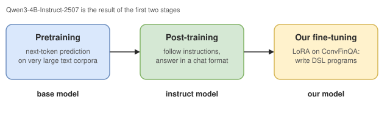
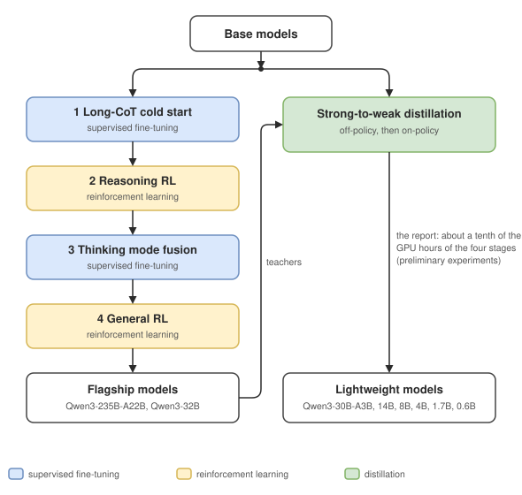

**You will learn:**

- what separates a base model from an instruct model, and where our fine-tuning fits;
- what a chat template is, and how a conversation becomes the string a model reads;
- how a multi-turn conversation is turned into a training example, and what teacher forcing means.

Qwen publishes most of its models twice: a **base** model and an **instruct** model. We fine-tune the
instruct one. This chapter explains the difference, shows it on the real models, and prepares the way
for the formatting chapter that follows.

## What "base" and "instruct" mean

A **base model** is the result of **pretraining**: it has been trained to predict the next token on a
very large body of text. For Qwen3 that is about 36 trillion tokens in 119 languages and dialects,
trained in three stages (a general stage, a reasoning-focused stage with more science, coding and
reasoning data, and a long-context stage). Some of the text is synthetic, in textbook, question and
answer, and instruction formats, generated by earlier Qwen models [@yang2025qwen3]. A base model
continues whatever text it is given. It was not trained to answer.

An **instruct model** is a base model that has been **post-trained** to follow instructions and to
converse in a chat format. For the Qwen3 family, the report describes a multi-stage pipeline for the
large models, with fine-tuning on reasoning data, reinforcement learning, and the merging of a
"thinking" and a "non-thinking" mode. The small models, including the 4B, were instead trained by
**strong-to-weak distillation**: they learn from the outputs and the logits of larger Qwen3 models
[@yang2025qwen3]. We do not need these methods in this lab, but a short tour of them, in the next
section, shows what post-training looks like.

The report calls the pretrained model `Qwen3-4B-Base` and the post-trained one `Qwen3-4B`, which can
either think before answering or not [@yang2025qwen3]. Our model, `Qwen3-4B-Instruct-2507`, is a later
release: its model card describes it as an updated *non-thinking* version of Qwen3-4B, which does not
write a reasoning section before its answer. The technical report was published before this update, and
we did not find a published description of how the update was trained, so we say nothing about that.

Two things the name does **not** tell us. The model was not trained for ConvFinQA or for our program
language, which is the gap this lab closes. And we do not know what financial text its training data
contained, because the data mixture is not published in detail.

{#fig-pipeline fig-alt="Three boxes joined by arrows. The first, pretraining, is next-token prediction on very large text corpora and produces a base model. The second, post-training, teaches following instructions and answering in a chat format and produces the instruct model. The third, our fine-tuning, uses LoRA on ConvFinQA to write DSL programs and produces our model."}

## What post-training looks like

@fig-posttraining redraws the report's overview of how the Qwen3 models were post-trained [@yang2025qwen3].
Everything starts from a base model and follows one of two routes, one for the large flagship models and
one for the lightweight ones, which include the 4B. The two routes are linked: the finished flagship
models serve as the teachers in the lightweight route.

{#fig-posttraining fig-alt="Flow chart. Base models split into two routes. On the left, the flagship route has four stages in order: long chain-of-thought cold start, reasoning reinforcement learning, thinking mode fusion and general reinforcement learning, ending in the flagship models Qwen3-235B-A22B and Qwen3-32B. An arrow from the flagship models leads into the distillation stage of the right-hand route, labelled teachers. On the right, the lightweight route is a single stage, strong-to-weak distillation, ending in the lightweight models Qwen3-30B-A3B and the 14B, 8B, 4B, 1.7B and 0.6B models. Stages are coloured by kind: supervised fine-tuning, reinforcement learning, or distillation."}

**The flagship route, in four stages**

1. **Long chain-of-thought cold start** (supervised fine-tuning). The model is fine-tuned on a curated set
   of math, code, logical-reasoning and science problems that have verified answers, with long
   step-by-step solutions. The aim is to teach basic reasoning patterns with few examples and few
   steps, so as not to limit the next stage.
2. **Reasoning RL** (reinforcement learning). The model is trained further on a few thousand problems
   whose answers can be checked automatically (the report uses 3,995 of them), rewarded when the
   answer is right, to improve its reasoning.
3. **Thinking mode fusion** (supervised fine-tuning). The model is fine-tuned on a mix of examples with
   and without a reasoning section, using a chat template that adds a `/think` or `/no_think` flag, so
   that one model can do both. We meet this template in the next section.
4. **General RL** (reinforcement learning). Reinforcement learning with rewards for over 20 kinds of
   task, among them following instructions, following formats, matching human preferences, using tools
   and answering from retrieved documents.

**The lightweight route: strong-to-weak distillation.** Instead of repeating the four stages for each
small model, the small model learns from a larger one. First it is fine-tuned on the larger models'
answers (*off-policy*, because the answers were not written by the student). Then the student writes its
own answers, and is trained so that its output probabilities match those of a Qwen3-32B or Qwen3-235B-A22B
teacher on the same text (*on-policy*). In the report's preliminary experiments this took about a tenth
of the GPU hours of the four-stage method.

Two kinds of training appear in this list: **supervised fine-tuning**, where the model is shown
examples and trained to reproduce them, and **reinforcement learning**, where it is rewarded for good
answers. In this lab we do only the first. Supervised fine-tuning on ConvFinQA turns is what we describe
in detail in the chapters to come, and the other methods are beyond our scope.

## Base and instruct, side by side

The previous two chapters already used the instruct model: its tokenizer, the architecture we took
apart, and the code-fenced answer to the AAPL question all came from `Qwen3-4B-Instruct-2507`. Now we
load the base model next to it and give both the same prompts. Two things are worth checking first.
The two tokenizers use the same vocabulary, so the same text becomes the same token ids, and they
differ in the token that ends a text:

```{python}
import gc

import pandas as pd
import torch
from transformers import AutoModelForCausalLM, AutoTokenizer

from convfinqa import data
from convfinqa.dsl import executor
from convfinqa.formatting import SYSTEM_PROMPT, conversation_messages

names = {"base": "Qwen/Qwen3-4B-Base", "instruct": "Qwen/Qwen3-4B-Instruct-2507"}
toks = {kind: AutoTokenizer.from_pretrained(name) for kind, name in names.items()}

sample = "Hello 206588 world"
assert toks["base"](sample)["input_ids"] == toks["instruct"](sample)["input_ids"]
print("vocabulary sizes:      ", {kind: len(t) for kind, t in toks.items()})
print("end-of-sequence token: ", {kind: t.eos_token for kind, t in toks.items()})
```

We use four prompts. Three have nothing to do with finance: a direct question, the start of a sentence,
and a question-and-answer pattern. The fourth is the first turn of the ConvFinQA conversation from the
previous chapters. Each prompt is given to each model in two forms: as **plain text**, and wrapped in the
model's **chat template**, which we look at in the next section. Decoding is greedy, and at most 60 new
tokens are generated.

```{python}
conv = {c["id"]: c for c in data.load_split("train")}[
    "Single_AAPL/2002/page_23.pdf-1"
]
page = data.context_text(conv)
question = conv["annotation"]["dialogue_break"][0]

def user(text):
    return [{"role": "user", "content": text}]

prompts = {
    "a question": (
        "What is the capital of France?",
        user("What is the capital of France?")
    ),
    "a sentence to complete": (
        "The capital of France is",
        user("The capital of France is")
    ),
    "a question-answer pattern": (
        "Q: What is 17 + 25?\nA:",
        user("Q: What is 17 + 25?\nA:")
    ),
    "ConvFinQA, turn 1": (
        f"{SYSTEM_PROMPT}\n\n{page}\n\nQuestion: {question}\nAnswer:",
        conversation_messages(conv)[:2],
    ),
}

def run(kind):
    """Generate for every prompt with one model, and keep its embedding
    matrix. Frees the GPU afterwards.
    """
    tok = toks[kind]
    model = AutoModelForCausalLM.from_pretrained(
        names[kind], dtype=torch.bfloat16
    ).to("cuda").eval()

    def generate(text):
        ids = tok(
            text,
            return_tensors="pt",
            add_special_tokens=False
        )["input_ids"].to("cuda")

        with torch.no_grad():
            out = model.generate(
                ids,
                max_new_tokens=60,
                do_sample=False,
                temperature=None,
                top_p=None,
                top_k=None,
                pad_token_id=tok.pad_token_id,
            )
        return tok.decode(out[0, ids.shape[1]:])

    results = {}
    for label, (plain, messages) in prompts.items():
        chat = tok.apply_chat_template(
            messages, tokenize=False, add_generation_prompt=True
        )
        results[label] = {
            "plain text": generate(plain),
            "chat template": generate(chat)
        }

    embeddings = model.model.embed_tokens.weight.detach().float().cpu()

    del model
    gc.collect()
    torch.cuda.empty_cache()

    return results, embeddings

outputs, embeddings = {}, {}
for kind in names:
    outputs[kind], embeddings[kind] = run(kind)
```

The outputs, cut to their first 90 characters (`<|endoftext|>` and `<|im_end|>` are the tokens that
end a text; a text that ends with neither was cut off at 60 tokens):

```{python}
shorten = lambda s, n=90: repr(s)[:n] + ("…" if len(repr(s)) > n else "")
for label in prompts:
    print(f"== {label}")
    for kind in names:
        for how in ("plain text", "chat template"):
            print(f"  {kind:8s} {how:13s} {shorten(outputs[kind][label][how])}")
```

What we see, on these four prompts:

- **Base model, plain text.** It answered the direct question and the plain-text ConvFinQA question,
  ending each with its end-of-text token. On the other two prompts it kept going: it finished the
  sentence and then wrote a true/false quiz question, and it answered the sum and then invented more
  questions in the same pattern. So the base model is a text continuer that also answers some prompts.
  This fits the report's remark that its pretraining data includes synthetic question-answering and
  instruction text [@yang2025qwen3], but we cannot tell from four prompts how much that explains.
- **Base model, chat template.** On the three short prompts it repeated the prompt and produced ordinary
  tokens (`ож`, an emoji) where the chat markers belong, and then looped. On the long ConvFinQA prompt it
  answered normally. We tried too few prompts to know how often each happens.
- **Instruct model, plain text.** It answers but does not end its answer: it keeps writing in the same
  vein (more capitals, the sum again, and on the ConvFinQA prompt an invented program).
- **Instruct model, chat template.** Clean answers, each ending with `<|im_end|>`.

**On the ConvFinQA prompt**, every output contains the right number, 5363. But the task is to write a
program in our DSL, so we hand each output to the executor from the DSL chapter:

```{python}
strip = lambda s: s.replace("<|endoftext|>", "").replace("<|im_end|>", "").strip()
rows = []
for kind in names:
    for how in ("plain text", "chat template"):
        out = outputs[kind]["ConvFinQA, turn 1"][how]
        value, error = executor.try_execute(strip(out))
        rows.append((kind, how, "5363" in out, value, error))
pd.DataFrame(
    rows,
    columns=["model", "prompt format", "contains 5363", "executed value", "error"]
)
```

None of the four outputs is a program the executor can run. The knowledge is there, but not the format,
and the format is what we will teach.

## What post-training did to the chat markers

The base model's odd behaviour with the chat template has a visible cause in its embeddings. We compare
the embedding vectors of the two chat markers and of the end-of-text token in the two models, with
2,000 randomly chosen ordinary tokens as a reference. For each token we print the vector's length
(norm), the cosine similarity of its vector in the two models, and how much it changed from the base to
the instruct model, relative to its length.

```{python}
special = {"<|endoftext|>": 151643, "<|im_start|>": 151644, "<|im_end|>": 151645}
generator = torch.Generator().manual_seed(0)
ordinary = torch.randint(0, 151000, (2000,), generator=generator)
base, instruct = embeddings["base"], embeddings["instruct"]
cosine = torch.nn.functional.cosine_similarity

def describe(label, ids):
    b, i = base[ids], instruct[ids]
    return (
        label,
        b.norm(dim=-1).median().item(),
        i.norm(dim=-1).median().item(),
        cosine(b, i, dim=-1).median().item(),
        ((b - i).norm(dim=-1) / b.norm(dim=-1)).median().item()
    )

table = pd.DataFrame(
    [describe("2,000 ordinary tokens (median)", ordinary)]
    + [describe(name, torch.tensor([i])) for name, i in special.items()],
    columns=[
        "token", "length in base", "length in instruct",
        "cosine, base vs instruct", "relative change"
    ],
).set_index("token").round(3)
print("cosine similarity of the <|im_start|> and <|im_end|> embeddings:",
      f"base {cosine(base[151644], base[151645], dim=0).item():.4f},",
      f"instruct {cosine(instruct[151644], instruct[151645], dim=0).item():.4f}")

table
```

In the base model, `<|im_start|>` and `<|im_end|>` have exactly the same embedding (cosine similarity
1.0000), and a short one (length 0.36, against about 1.2 for ordinary tokens), so the base model cannot
tell the two markers apart. In the instruct model they differ (0.567), and during post-training they
moved by about their own length (relative change 0.94 and 1.15), while ordinary tokens moved by about
0.19. The ordinary tokens are otherwise very similar between the two models (median cosine similarity
0.98), so the two models are closely related. Identical, short vectors are what we would expect from
rows that the base model never trained, though the report does not say so, and this is our inference.
It fits what we saw: given the template, the base model has no meaning for the markers, and writes
ordinary tokens where they should be.

The chat markers are not decoration. They are part of what post-training installs, and the format we use
for fine-tuning has to match the one the instruct model learned. The next section looks at that format.

## Chat templates

A chat is a list of messages, each with a role (`system`, `user` or `assistant`) and some text. A model
reads one sequence of tokens, so something has to turn the list into that sequence. That is the job of
the **chat template**: a small program, shipped with the tokenizer, that wraps every message in the
markers the model was post-trained on. Here is our model's template applied to a short conversation, with
the markers `<|im_start|>` and `<|im_end|>` that the base model could not tell apart:

```{python}
from convfinqa.book.viz import show_tokens

example = [
    {"role": "system", "content": "Answer with a program."},
    {"role": "user", "content": "Q1?"},
    {"role": "assistant", "content": "A1"},
    {"role": "user", "content": "Q2?"},
]
tok = toks["instruct"]
rendered = tok.apply_chat_template(
    example, tokenize=False, add_generation_prompt=True
)
print(rendered)
```

Each message becomes `<|im_start|>`, the role, a newline, the text, `<|im_end|>` and a newline. The last
line is the **generation prompt**, `<|im_start|>assistant` and a newline, added because we asked for it:
it marks the place where the model's answer begins, and the model then writes the answer and ends it
with `<|im_end|>`, which is how generation knows to stop. Each marker is a single token:

```{python}
print("marker ids:", tok.convert_tokens_to_ids(["<|im_start|>", "<|im_end|>"]),
      "| the end-of-sequence token is", tok.eos_token)
show_tokens(tok, rendered)
```

**The original Qwen3 format.** The Qwen3 report describes a template that also controls "thinking"
(its Table 9). A user message can end with a `/think` or `/no_think` flag, and an assistant turn starts
with a `<think>` block holding its reasoning, which is empty for a non-thinking answer. The base
model's tokenizer still ships that template, with a parameter `enable_thinking`. Our instruct model's
template has none of this, because the model never thinks out loud:

```{python}
base_tok = toks["base"]
for flag in (True, False):
    s = base_tok.apply_chat_template(
        example, tokenize=False, add_generation_prompt=True, enable_thinking=flag
    )
    print(f"base template, enable_thinking={flag}: ...{s[-45:]!r}")
print(
    "our model's template mentions thinking:",
    "think" in toks["instruct"].chat_template
)

# a /no_think flag in the user's text is just text: the template only copies it
ask = lambda text: base_tok.apply_chat_template(
    [{"role": "user", "content": text}],
    tokenize=False,
    add_generation_prompt=True
)
print(
    "the template treats the flag as plain text:",
    ask("Q? /no_think") == ask("Q?").replace("Q?", "Q? /no_think")
)
```

With thinking switched off, the original template ends the generation prompt with an empty think block,
as the report describes. The `/think` flags are not added by the template: they are text that the user
types into the message.

**Why this matters for us.** The template is part of the model's interface. A fine-tuning example must be
rendered with exactly the template the model was post-trained on, so that the markers around our
programs mean what the model expects. In our training examples the system message states the task, the
user message holds the page and the question, and the assistant message is the gold program. The model
learns to write the program and then `<|im_end|>`. The newline after `<|im_end|>` is only template
text, and the model never has to produce it.

## Teacher forcing and exposure bias

How does a multi-turn conversation become a training example? We use the standard approach to multi-turn
supervised fine-tuning. The whole conversation, rendered by the template, goes into **one sequence**,
and the model is trained to predict every assistant token given everything before it, including the
**gold** (correct) earlier answers. Feeding the model the correct history, instead of its own earlier
outputs, is called **teacher forcing**. It has a benefit and a cost.

**The benefit is efficiency.** One pass computes the loss on all turns at once. Because a position only
sees earlier tokens, this equals training on each truncated prefix separately (the anatomy chapter
explained why, and the project's tests check it), but the page is read once instead of once per turn.
The alternative is a **per-turn layout**, in which every turn is its own example with the history as its
prompt. ConvFinQA's own per-turn files are in that layout. We can count what it costs on the training
split:

```{python}
count = lambda messages: len(
    tok(
        tok.apply_chat_template(messages, tokenize=False),
        add_special_tokens=False
    )["input_ids"]
)

whole = per_turn = turns = 0
conversations = data.load_split("train")
for c in conversations:
    messages = conversation_messages(c)
    n_turns = (len(messages) - 1) // 2
    whole += count(messages)
    per_turn += sum(
        count(messages[: 1 + 2 * k])
        for k in range(1, n_turns + 1)
    )
    turns += n_turns

print(f"{len(conversations):,} conversations, {turns:,} turns")
print(f"tokens with one sequence per conversation: {whole:,}")
print(
    f"tokens with one sequence per turn:         {per_turn:,}"
    f"  ({per_turn / whole:.2f} times as many)"
)
```

The per-turn layout processes about three and a half times as many tokens, for the same learning signal,
which is why it is the less common choice for multi-turn data.

**The cost is exposure bias.** During training the history is always right. At test time the model
reads its own earlier answers, which may be wrong, and a wrong early answer changes what follows, so
errors compound. The model has never been trained on its own mistakes. Our evaluation reports both
settings: with the **gold history**, which is the teacher-forced setting and an upper bound, and with
the model's **predicted history**, which is what a real user would experience.

The methods that address exposure bias train on the model's own outputs. The on-policy distillation
and the reinforcement learning stages of the Qwen3 pipeline are examples [@yang2025qwen3]. They are
beyond the scope of this lab, and training on predicted histories is one of the extensions we suggest
at the end of the book.

## Where our fine-tuning fits

@fig-pipeline shows the place of our work. We start from the instruct model, which already knows how to
read a chat and answer it, and teach it one narrow task: reading a financial page and a question and
writing a program in the DSL. The step is small compared with pretraining and post-training, and a
later chapter describes it in detail.
