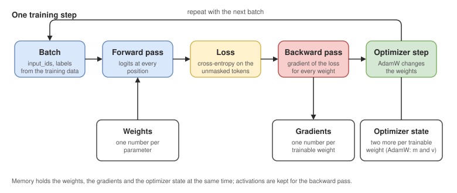

# How fine-tuning works {#sec-fine-tuning}

**You will learn:**

- what one training step does, and what the computer holds in memory while it runs;
- which tokens of a conversation the loss counts, and why the model's prediction at one position is
  scored against the *next* token;
- how the loss is computed by hand, and why the number matches the one the library reports.

Fine-tuning has no special machinery. It is the training that produced the model, run again on a small
amount of new data: the same loss, the same optimizer, the same steps. What changes is the data (a few
thousand ConvFinQA conversations) and, with LoRA, which weights are allowed to move. This chapter looks
at one step, and @sec-lora at the shortcut LoRA takes.

## One training step

A model is a function with a very large number of adjustable numbers, its **weights**. Training adjusts
them so that the model predicts the training text better, in four moves that repeat until we stop
(@fig-training-step).

{#fig-training-step fig-alt="Flow diagram of one training step. Five boxes in a row joined by arrows: Batch, Forward pass, Loss, Backward pass, Optimizer step. An arrow from the Optimizer step returns over the top to the Batch, labelled repeat with the next batch. Below, a Weights box has an arrow up into the Forward pass, a Gradients box receives an arrow down from the Backward pass, and an Optimizer state box is joined to the Optimizer step."}

1. **Batch.** A few conversations, already turned into token ids (`input_ids`) and a second array of the
   same length, the `labels`, which says which tokens count (next section).
2. **Forward pass.** The model reads the tokens and produces **logits**: a score for every token of the
   vocabulary at every position. This is the computation from @sec-tokens, but over whole sequences at
   once instead of one next token.
3. **Loss.** The logits are turned into probabilities, and the loss is the average of
   $-\log p$ of the correct next token over the tokens that count. It is one number: small when the
   model gave the right tokens high probability.
4. **Backward pass.** For each weight, the **gradient** says how much the loss would change if that weight
   changed a little. It is computed by working backwards through the forward pass, the chain rule applied
   layer by layer (**backpropagation**).
5. **Optimizer step.** Each weight moves a small step against its gradient. The size of the step is the
   **learning rate**. We use **AdamW**, which does not step by the raw gradient: it keeps two running
   averages per weight, of the gradient and of its square, and scales every step by them. Those averages
   are the *optimizer state*, and they persist from step to step.

Then the next batch, and again. Everything in this chapter's second half is a detail of this loop:
how the learning rate changes over time, how several small batches add up to one large one, and how much
memory each white box takes.

::: {.callout-note title="Under the hood"}
Only weights that are **trainable** get a gradient and an optimizer state. In full fine-tuning that is
all four billion of them, so gradients and optimizer state need far more memory than the model itself.
LoRA freezes the original weights and trains a small set of added ones, so the gradients and the
optimizer state shrink to that small set. The memory budget later in this chapter puts numbers on this,
and @sec-lora shows how it does it.
:::

## Which tokens count

The loss needs a target for every position, and a language model's target is always the same: **the next
token**. At each position the model reads everything up to and including that token, and its output is a
distribution over what comes after it. @fig-label-shift shows the end of one conversation, where the
assistant answers `189`.

{#fig-label-shift fig-alt="Three rows of eight aligned boxes. The top row, input ids, reads: an ellipsis for the context, im_start, assistant, newline, 1, 8, 9, im_end. The middle row shows the token each position must predict, which is the next token in the top row: im_start, assistant, newline, 1, 8, 9, im_end, and for the last position nothing. The bottom row says whether the position counts in the loss: no for the first three, yes for the next four, and no for the last. The boxes for the answer tokens 1, 8, 9 and im_end are green; the others grey."}

Three things to notice.

- **The shift.** The position that reads the newline after `assistant` is scored on `1`, the first token of
  the answer. That is the position where the model "decides" what to answer. The position that reads
  `<|im_end|>` has nothing to predict, because the training text stops there (the newline the chat
  template writes after it is not trained).
- **The mask.** In our data the answer is only a few tokens, and the page and the question are many
  hundreds. The model never has to predict the question, so the loss ignores it: in the `labels` array
  every position that is not part of an answer holds `-100`, the value PyTorch's cross-entropy skips by
  default. @sec-probing already used this mask: `tokenize_conversation` returns the `input_ids` and these
  `labels`.
- **The end marker counts.** `<|im_end|>` is a trained token. Learning to *stop* after a program is part of
  the task; without it the model would run on into a new question.

With $A$ the set of positions whose label is not `-100`, the loss is

$$
L \;=\; -\frac{1}{|A|} \sum_{t \in A} \log p_\theta\!\left(x_t \mid x_1, \dots, x_{t-1}\right),
$$

the mean surprisal of the answer tokens: exactly what @sec-probing measured for the untuned model on the
validation split. There the value was the starting point of fine-tuning; each step of the loop above
moves it down.

## The loss by hand

We can check the formula on a real conversation. The library computes the loss for us when we pass
`labels=` to the model; here we compute it ourselves from the logits and compare. The conversation is the
validation conversation with exactly three turns and the shortest programs, so that its answer tokens fit
on a page. The model is the 4B model we fine-tune.

The by-hand computation is four lines. Position $t$ is scored on token $t+1$, so the logits drop their last
position and the labels drop their first. The positions whose label is `-100` are thrown away. For the
rest we take the log-probability of the correct token and average its negative.

```python
logp = torch.log_softmax(logits[:-1].float(), dim=-1)   # position t: distribution over token t+1
target = labels[1:]                                     # the token it must predict, or -100
picked = logp.gather(1, input_ids[1:, None])[:, 0]      # log p of the next token, at every position
loss = -picked[target != -100].mean()
```

(`probing.loss_terms` does exactly this, and a test with a tiny model checks it against the library.)

```{python}
#HEAVY
import pandas as pd

from convfinqa.artifacts import artifact, get


@artifact("loss_by_hand", deps=["train_val_split"], heavy=True)
def build_loss_by_hand(out, deps):
    import json

    import torch
    from transformers import AutoModelForCausalLM, AutoTokenizer

    from convfinqa.formatting import conversation_messages
    from convfinqa.probing import loss_check

    val = list(deps["train_val_split"].jsonl("val.jsonl"))
    three = [c for c in val if len(c["annotation"]["turn_program"]) == 3]
    conv = min(
        three, key=lambda c: sum(len(p)
        for p in c["annotation"]["turn_program"])
    )
    name = "Qwen/Qwen3-4B-Instruct-2507"
    tok = AutoTokenizer.from_pretrained(name)
    model = AutoModelForCausalLM.from_pretrained(
        name, dtype=torch.bfloat16, device_map="cuda"
    ).eval()
    result = loss_check(model, tok, conversation_messages(conv))
    result["id"] = conv["id"]
    (out / "check.json").write_text(json.dumps(result))

check = get("loss_by_hand").json("check.json")
print(
    f"conversation {check['id']}: {check['n_tokens']:,} tokens, "
    f"{check['n_counted']} of them in the loss"
)
print(f"by hand:       {check['by_hand']:.6f}")
print(f"model(labels): {check['library']:.6f}")
assert abs(check["by_hand"] - check["library"]) < 1e-4
```

The two agree to well within the $10^{-4}$ we require. The sum behind the by-hand number, term by term,
with each answer token shaded by its surprisal (hover for the probability):

```{python}
from IPython.display import HTML

from convfinqa.book.viz import surprisal_html

surprisals = pd.Series(
    check["surprisals"], index=[repr(t) for t in check["tokens"]]
)
print(
    f"{len(surprisals)} tokens, sum {surprisals.sum():.3f}, "
    f"mean {surprisals.mean():.4f}"
)
display(HTML(
    surprisal_html(check["tokens"], [-s for s in check["surprisals"]])
))
surprisals.nlargest(4).round(3).rename("−log p").to_frame()
```

Each term is the surprisal of @sec-probing for one answer token: the model's probability for it, read off
at the position before it. Most are near zero, because the model can copy a number it has just seen; a
few carry nearly all of the sum, and their mean is the loss.

**What happens without the mask.** Leave the mask out and average over every position, the page and the
question included, and the loss looks better:

```{python}
n_positions = check["n_tokens"] - 1
answer_total = sum(check["surprisals"])
rest = (check["no_mask"] * n_positions - answer_total)\
    / (n_positions - check["n_counted"])
pd.Series({
    "with the mask (answer tokens only)": check["by_hand"],
    "without the mask (every position)": check["no_mask"],
    f"the other {n_positions - check['n_counted']:,} positions alone": rest,
}, name="mean loss").round(3).to_frame()
```

**This lower number is misleading, not better.** The model has not become better at writing programs. It
is the same model on the same answer. Only the average changed, because the answer tokens are now
`{python} check["n_counted"]` of `{python} f"{n_positions:,}"` positions, and the rest are easier: about
`{python} f"{rest:.2f}"` nats per token, against `{python} f"{check['by_hand']:.2f}"` for the answer.
The model predicts a page of financial prose, with numbers it can copy, better than it predicts a program
in a language it was never taught. With 99% of the weight on those positions, the hard tokens that decide
the task are diluted, and the result moves with the length of the page, not with the quality of the answer.
It would also have the model spend its training effort on predicting the question and the page, which are
inputs we never ask it to produce. A loss that falls when the page gets longer is not measuring what we
care about. This is why the mask matters.

**It agrees with @sec-probing, too.** That chapter measured the mean gold-program loss over the whole
validation split with a different piece of code, `gold_logprobs`. For this one conversation its number
is in the saved result, and matches:

```{python}
val_ids = [c["id"] for c in get("train_val_split").jsonl("val.jsonl")]
tokens_24, total_24 = get("val_gold_nll").json("nll.json")\
    ["per_conversation"][val_ids.index(check["id"])]
print(f"probing chapter: {tokens_24} tokens, mean {total_24 / tokens_24:.4f}")
print(f"this chapter: {check['n_counted']} tokens, mean {check['by_hand']:.4f}")
assert tokens_24 == check["n_counted"]\
    and abs(total_24 / tokens_24 - check["by_hand"]) < 1e-3
```

The loss we compute by hand, the one the library reports and the surprisal we plotted in @sec-probing are
the same quantity, computed three ways. The training chapter relies on it: its step-0 validation loss is this mean
over the validation split.

## From the loss to a weight change

The loss is one number. The optimizer needs, for every weight, a direction and a size of step. This
section covers where the direction comes from (backpropagation), what clipping and AdamW do with it, and how
the step size changes over a run.

### Backpropagation and clipping

The gradient of the loss with respect to a weight says how much the loss changes if that weight changes
a little. A model is a long chain of simple operations, so the gradients follow from the **chain rule**,
applied from the loss backwards: the gradient at the output is passed back through each operation,
multiplied by that operation's own derivative. PyTorch records the operations during the forward pass and
does this for us. In the 4B model the chain has 36 layers. This is why the backward pass needs the forward
pass's intermediate values (the activations, whose cost we measure below), and why only a **trainable**
weight gets a gradient: with LoRA the original weights are frozen, and the chain rule is applied only for
the small added matrices.

Before the optimizer uses the gradients, the Trainer limits their overall size. If the norm of all the
gradients taken together is above a threshold (`max_grad_norm`, 1.0 by default), every gradient is scaled
down by the same factor, which keeps the direction and shortens the step. It protects a run from one
unusually bad batch.

### AdamW

The simplest optimizer moves each weight against its gradient, $\theta \leftarrow \theta - \eta\, g$, with
$\eta$ the learning rate. It has two problems at this scale. Gradients differ enormously in size from one
weight to the next, so one learning rate is too large for some weights and too small for others; and each
gradient comes from a few conversations only, so it is noisy.

**Adam** [@kingma2015adam] answers both by keeping two running averages for every weight, updated at every
step $t$ from its gradient $g_t$:

$$
m_t = \beta_1 m_{t-1} + (1-\beta_1)\, g_t, \qquad
v_t = \beta_2 v_{t-1} + (1-\beta_2)\, g_t^2 .
$$

$m$ is a smoothed gradient, a direction less sensitive to one noisy batch; $v$ is the typical size of the
squared gradient. Both start at zero and so are too small early on, which is corrected by dividing by
$1-\beta^t$. The step is the smoothed direction measured in units of the typical size:

$$
\hat m_t = \frac{m_t}{1-\beta_1^t}, \quad \hat v_t = \frac{v_t}{1-\beta_2^t}, \qquad
\theta_t = \theta_{t-1} - \eta\left(\frac{\hat m_t}{\sqrt{\hat v_t}+\varepsilon} + \lambda\,\theta_{t-1}\right).
$$

The last term is **weight decay** with strength $\lambda$, which pulls each weight a little towards zero.
**AdamW** [@loshchilov2019adamw] applies it to the weight directly, as above, instead of folding it into the
gradient before the averages, which is what plain Adam with an L2 penalty does. The defaults are
$\beta_1=0.9$, $\beta_2=0.999$, $\varepsilon=10^{-8}$. The Trainer's `weight_decay` is 0 by default, and
we leave it there.

Two consequences. On the very first step $\hat m_1/\sqrt{\hat v_1}$ is just the sign of the gradient, so
every weight moves by about the learning rate, whatever the size of its gradient: Adam's step is set by
the learning rate, not by how large the gradient happens to be, which is why one learning rate works for
the whole network. And $m$ and $v$ are the **optimizer state** of the training-step diagram: two numbers
for every trainable weight, kept for as long as training lasts. That is what makes full fine-tuning
memory-hungry, and what LoRA avoids by training a few million weights instead of four billion.

## The learning-rate schedule

The learning rate $\eta$ is not constant. The planned run uses a **linear warmup** followed by a **cosine
decay**, both changing the rate at every optimizer step.

- **Warmup.** At the start the averages $m$ and $v$ are estimated from one or two batches and the first
  steps are the least reliable of the run, so the rate rises linearly from 0 to its peak over the first few
  steps. Warmup is a standard remedy for unstable starts, introduced for large-batch training
  [@goyal2017accurate].
- **Cosine decay.** After the peak the rate falls along half a cosine wave to 0, slowly at first, fastest
  in the middle, and slowly again at the end [@loshchilov2017sgdr]. The large early rate makes quick
  progress, and the small late rate lets the weights settle.

How many steps is that? A step is one batch of 16 conversations (micro-batches of 4, accumulated 4
times), and the run goes twice over train-fit.

```{python}
import math

import matplotlib.pyplot as plt
import torch
from transformers import get_cosine_schedule_with_warmup

n_fit = sum(1 for _ in get("train_val_split").jsonl("train_fit.jsonl"))
effective_batch, epochs, peak_lr, warmup_ratio = 16, 2, 2e-4, 0.03

# Compute total steps and warmup steps for `epochs` epochs
total = math.ceil(n_fit / effective_batch) * epochs
warmup = math.ceil(total * warmup_ratio)
print(
    f"{n_fit:,} conversations / {effective_batch} per step = "
    f"{math.ceil(n_fit / effective_batch)} steps per epoch"
)
print(
    f"{epochs} epochs = {total} optimizer steps; "
    f"warmup {warmup_ratio:.0%} = {warmup} steps"
)

# Create a dummy parameter and optimizer to simulate the learning rate
# schedule
dummy = torch.nn.Parameter(torch.zeros(1))
opt = torch.optim.AdamW([dummy], lr=peak_lr)
sched = get_cosine_schedule_with_warmup(
    opt, num_warmup_steps=warmup, num_training_steps=total
)


# Compare the library's learning rate schedule with the analytical formula
library = []
for _ in range(total + 1):
    library.append(opt.param_groups[0]["lr"])
    opt.step()
    sched.step()

def lr_at(step):
    if step < warmup:
        return peak_lr * step / warmup
    progress = (step - warmup) / (total - warmup)
    return peak_lr * 0.5 * (1 + math.cos(math.pi * progress))

assert all(abs(library[s] - lr_at(s)) < 1e-12 for s in range(total + 1))

# Print key learning rate values at important steps (initial, end of warmup, mid, final)
print(f"learning rate: step 0 {library[0]:.1e}, step {warmup} {library[warmup]:.1e}, "
      f"step {total // 2} {library[total // 2]:.1e}, step {total} {library[total]:.1e}")
```

```{python}
#| label: fig-lr-schedule
#| fig-cap: "The learning rate of the planned run: a linear warmup to 2e-4 over 11 steps, then a half-cosine decay to 0 at step 342. Dotted lines mark the validation checks, every 50 steps."
#| fig-alt: "Line chart of learning rate against optimizer step, 0 to 342. The rate climbs in a straight line from 0 to 2e-4 at step 11, then falls along a smooth curve, half a cosine wave, reaching 0 at step 342. Vertical dotted lines mark steps 50, 100, 150, 200, 250 and 300."
fig, ax = plt.subplots(figsize=(7, 3.2))

# Plot the learning rate schedule
ax.plot(library, color="#3b6ea5", lw=2)

# Add vertical lines each 50 steps
for s in range(50, total, 50):
    ax.axvline(s, color="grey", ls=":", lw=0.8)

# Highlight the end of the warmup with a vertical line and annotation
ax.axvline(warmup, color="#b85450", ls="--", lw=1)
ax.annotate(
    f"end of warmup (step {warmup})", (warmup, peak_lr),
    xytext=(warmup + 4, peak_lr * 0.45),
    fontsize=9, color="#b85450", va="top", ha="left",
    arrowprops={"arrowstyle": "-", "color": "#b85450", "lw": 0.8}
)

ax.set_xlabel("optimizer step")
ax.set_ylabel("learning rate")
ax.set_xlim(0, total)
ax.set_ylim(0, peak_lr * 1.08)
fig.tight_layout()
plt.show()
```

The scheduler is the library's, and the formula above (the usual one: a straight line up, then
$\tfrac12(1+\cos\pi p)$ with $p$ the fraction of the post-warmup steps done) reproduces it at every step.
With the Trainer this is two settings: `lr_scheduler_type="cosine"` and `warmup_steps=0.03`; in this
version of the library a warmup below 1 is read as a fraction of all steps, and rounded up.

## Gradient accumulation and the effective batch

Each optimizer step uses the gradient of **16 conversations**, the **effective batch**. But 16 conversations
of up to 3,584 tokens at once need more activation memory than we want to spend (the measurement below
shows 34 GB for the longest *four*). **Gradient accumulation** gets the same step from smaller pieces:

1. run a forward and backward pass on a **micro-batch** of 4 conversations;
2. do *not* step the optimizer: PyTorch's `backward()` **adds** to the gradients already stored;
3. repeat 4 times;
4. take one optimizer step on the sum, and clear the gradients.

In the Trainer these are `per_device_train_batch_size=4` and `gradient_accumulation_steps=4`. The
effective batch, $4 \times 4 = 16$, is what sets the number of steps per epoch (171) and so the whole
schedule of the previous section. The micro-batch size only affects speed and memory.

### The loss must be divided by the right number

Accumulation gives the same gradient as one large batch only if the loss is scaled correctly. Our loss
is a mean over the answer tokens, and micro-batches have different numbers of answer tokens. Averaging four
micro-batch means is then **not** the mean over all the tokens of the 16 conversations:

$$
\underbrace{\frac14 \sum_{b=1}^{4} \frac{1}{M_b} \sum_{t \in b} \ell_t}_{\text{mean of micro-batch means}}
\;\neq\;
\underbrace{\frac{1}{N} \sum_{b=1}^{4} \sum_{t \in b} \ell_t}_{\text{mean over all tokens}},
\qquad N = M_1 + M_2 + M_3 + M_4 ,
$$

with $\ell_t$ the loss of one answer token and $M_b$ the number of answer tokens in micro-batch $b$. On the
left a token in a micro-batch with few answer tokens counts for more. How much more, for our data? Take
the validation conversations' answer-token counts from @sec-probing and form random steps of 16:

```{python}
import random

counts = [
    n for n, _ in get("val_gold_nll").json("nll.json")["per_conversation"]
]
rng = random.Random(0)
ratios = []
for _ in range(5000):
    step = rng.sample(counts, 16)
    micro = [sum(step[i : i + 4]) for i in range(0, 16, 4)]

    # weight of a token on the left / on the right
    ratios += [sum(micro) / 4 / m for m in micro]

pd.Series(ratios, name="weight ratio").describe(
    percentiles=[0.05, 0.25, 0.5, 0.75, 0.95]
).round(2).to_frame().T
```

A ratio of 1 would be the same weight on both sides. Half of the micro-batches are within about 10 to 20%
of it (0.89 to 1.18); one in ten is off by 30% or more (below 0.70 or above 1.44), and the extremes are 0.48
and 2.23. The error is not huge, but it is systematic: tokens in a micro-batch with few answer tokens are
over-weighted, and the gradient is not the one we are describing.

The fix is to add the losses as **sums** and divide by the token count of the *whole* accumulated batch,
$N$, once. This is what the Trainer does in this version of the library: it counts the answer tokens of all
four micro-batches first (`num_items_in_batch`) and divides every micro-batch's summed loss by that
count. The Trainer run at the end of this chapter does the same.

### What the effective batch changes

- **Noise.** The gradient of 16 conversations is a better estimate of the gradient over the whole dataset
  than the gradient of 4, with less variance from batch to batch. A larger effective batch generally tolerates a
  larger learning rate, and means fewer steps.
- **Steps.** With 2,731 conversations, a batch of 16 gives 171 steps per epoch and 342 in two epochs. Doubling
  the batch would halve the number of updates, so the learning rate and the schedule would have to be
  chosen again.
- **Not memory or speed.** Accumulating 4 micro-batches of 4 costs about what 16 at once would in
  compute, and holds only one micro-batch's activations at a time. That is the whole point.

## What gradient checkpointing costs

The backward pass needs the intermediate values of the forward pass, the **activations**, at every layer.
Normally they are all kept in memory until the backward pass uses them. For a 36-layer model and
conversations of up to 3,584 tokens that can take more memory than the weights do. **Gradient
checkpointing** keeps only the input of each layer, and recomputes the layer's inner values when the
backward pass reaches it: less memory, in exchange for an extra forward pass per step.

Whether that exchange is worth making depends on the hardware, so we measure it. Each run below is a
short real training loop on train-fit conversations, with the shape of the planned run: micro-batches of 4
conversations, 4 of them accumulated into one optimizer step (an effective batch of 16), `max_length`
3,584. After 2 warm-up steps, 5 steps are timed, and peak GPU memory is recorded for them and for one
worst-case micro-batch, the four longest conversations of train-fit. These are not training runs; they
only measure.

Two models are measured. The **0.5B** model with all weights trained shows the effect cheaply. The
**4B** model with LoRA (rank 16, see @sec-lora) is the configuration of the main run in the training chapter, and the
one whose answer we need.

```{python}
#HEAVY
from convfinqa.artifacts import artifact, get


@artifact(
    "step_cost_{model}_{mode}_{ckpt}",
    deps=["train_val_split"],
    files=["configs/step_cost.json"],
    heavy=True,
)
def build_step_cost(out, deps, files, *, model: str, mode: str, ckpt: str):
    import json

    from convfinqa.step_cost import measure

    cfg = files["configs/step_cost.json"].json()
    result = measure(
        cfg["models"][model],
        list(deps["train_val_split"].jsonl("train_fit.jsonl")),
        lora=cfg["lora"] if mode == "lora" else None,
        checkpointing=ckpt == "on",
        lr=cfg["lr"][mode],
        micro_batch=cfg["micro_batch"],
        accumulation=cfg["accumulation"],
        warmup_steps=cfg["warmup_steps"],
        steps=cfg["steps"],
        max_length=cfg["max_length"],
        seed=cfg["seed"],
        memory_cap_gb=cfg["memory_cap_gb"],
    )
    (out / "cost.json").write_text(json.dumps(result))

costs = {
    ("0.5B, full fine-tuning", "off"):
        get("step_cost_small_full_off").json("cost.json"),
    ("0.5B, full fine-tuning", "on"):
        get("step_cost_small_full_on").json("cost.json"),
    ("4B, LoRA r=16", "off"):
        get("step_cost_main_lora_off").json("cost.json"),
    ("4B, LoRA r=16", "on"):
        get("step_cost_main_lora_on").json("cost.json"),
}
```

```{python}
import pandas as pd

from convfinqa.step_cost import estimate_hours

n_fit = sum(1 for _ in get("train_val_split").jsonl("train_fit.jsonl"))

cap = next(iter(costs.values()))["memory_cap_gb"]
over = f"over the {cap:g} GB cap"
rows = []
for (setting, checkpointing), c in costs.items():
    ok = c["median_step_s"] is not None
    rows.append({
        "setting": setting,
        "checkpointing": checkpointing,
        "trainable parameters": f"{c['trainable_params']:,}",
        "weights (GB)": c["weights_gb"],
        "peak, typical steps (GB)":
            c["typical_peak_gb"] if ok else over,
        "peak, longest batch (GB)":
            c["worst_peak_gb"] if c["worst_peak_gb"] is not None else over,
        "seconds per step": c["median_step_s"] if ok else None,
        "hours for 2 epochs":
            estimate_hours(c["median_step_s"], n_fit, 2, 16) if ok else None,
    })
pd.DataFrame(rows).round(2).set_index(["setting", "checkpointing"])
```

How to read the table:

- **Peak memory** is the highest GPU memory the process had allocated, in the typical steps and in the one
  worst-case micro-batch (the four longest conversations, each over 3,000 tokens). The longest batch is the
  one that decides whether a run survives: a run that fits on average can still fail on one bad batch.
- **Seconds per step** is the median of the 5 timed steps; each step is 4 micro-batches. **Hours for 2
  epochs** multiplies it by the 342 optimizer steps of the planned run (2,731 conversations × 2 epochs ÷ 16).
  It is an extrapolation from a short run, and leaves out evaluation.
- **Precision.** The weights are bf16 throughout. With full fine-tuning the gradients and AdamW state are
  bf16 too, as these runs do; with LoRA, PEFT keeps the small trainable matrices in fp32 and the frozen
  base in bf16.
- A run that goes over the memory cap is marked as such. The cap (80 GB of the machine's 121 GB) is there
  because this GPU shares its memory with the desktop, and a run that takes everything freezes the machine.
  Our first attempt at the 4B run without checkpointing had no cap, and did exactly that: the desktop
  session froze and the machine had to be restarted.

**What the numbers say.**

- On the 0.5B model, checkpointing cuts the peak memory of the typical steps from 26 GB to 16 GB, and of the
  longest batch from 47 GB to 27 GB, and makes a step about 18% slower (3.3 s to 3.9 s). That is the
  trade: roughly two fifths less memory for a fifth more time.
- On the 4B model with LoRA, **without checkpointing the run does not fit** in 80 GB at a micro-batch of 4.
  The weights are only 7.6 GB; it is the activations of 36 layers over thousands of tokens, and the
  logits (the output over a 152,000-token vocabulary at every position), that fill the memory. With
  checkpointing the peak is 21 GB on typical steps and 34 GB on the longest batch, so there is plenty of
  room left.
- So the main run keeps gradient checkpointing on. At about 41 s per optimizer step it takes roughly 4
  hours for 2 epochs, longer than the 1 to 2 hours we first guessed.

What we did not measure is the 4B run without checkpointing at a smaller micro-batch, which might fit
and be faster. That is a tuning question for the training chapter, where it can be tried with the real run.

## The memory budget

What does a training step hold in memory? Four things (@fig-training-step). Three of them are set by the
number of parameters and by how many bytes each takes:

- the **weights**: every parameter, in its stored precision;
- the **gradients**: one number per *trainable* parameter;
- the **optimizer state**: AdamW's $m$ and $v$, two more numbers per trainable parameter.

The fourth, the **activations** (the forward pass's intermediate values, kept for the backward pass) and the
**logits** (a score for each of the 152,000 vocabulary entries at every position), depends on the batch and
the sequence length instead. We measured the sum of everything in the previous section; the first three
we can compute, which leaves the fourth as the difference. (GB below means $2^{30}$ bytes, as in PyTorch's
memory counters.)

```{python}
GB = 1024**3
small = costs[("0.5B, full fine-tuning", "on")]
lora = costs[("4B, LoRA r=16", "on")]
base = lora["total_params"] - lora["trainable_params"]

# the parameter count found in the anatomy chapter
assert base == 4_022_468_096

trainable = lora["trainable_params"]

def static(weights, grads, state):
    """Bytes per part -> GB."""
    return {
        "weights": weights / GB,
        "gradients": grads / GB,
        "optimizer state": state / GB
    }

scenarios = {
    # name: (static parts, measured result or None)
    "0.5B, full fine-tuning, bf16": (
        static(2 * small["total_params"],
        2 * small["total_params"],
        4 * small["total_params"]),
        small
    ),
    "4B, LoRA r=16": (
        static(2 * base + 4 * trainable, 4 * trainable, 8 * trainable),
        lora
    ),
    "4B, full fine-tuning, bf16": (
        static(2 * base, 2 * base, 4 * base),
        None
    ),
    "4B, full fine-tuning, fp32 weights": (
        static(4 * base, 4 * base, 8 * base),
        None
    ),
}

# The computed weights agree with what was measured after loading the models.
assert abs(
    scenarios["0.5B, full fine-tuning, bf16"][0]["weights"]
    - small["weights_gb"]
) < 0.02
assert abs(
    scenarios["4B, LoRA r=16"][0]["weights"]
    - lora["weights_gb"]
) < 0.02

rows = []
for name, (parts, measured) in scenarios.items():
    row = {
        "setting": name,
        **{k: round(v, 1) for k, v in parts.items()},
        "static total": round(sum(parts.values()), 1)
    }
    if measured:
        row["activations + logits, typical"] = round(
            measured["typical_peak_gb"] - sum(parts.values()), 1
        )
        row["activations + logits, longest batch"] = round(
            measured["worst_peak_gb"] - sum(parts.values()), 1
        )
    rows.append(row)
pd.DataFrame(rows).set_index("setting")
```

How the bytes are counted: with LoRA the 4B weights stay in bf16 (2 bytes each) and only the adapters,
33 million parameters in fp32 (4 bytes), have gradients and state. Full fine-tuning in bf16, as the 0.5B run
above did, uses 2 bytes for each of weight, gradient, $m$ and $v$: 8 bytes per parameter. The usual
**mixed-precision** recipe keeps fp32 weights and does the arithmetic in bf16, which doubles all of it, to 16
bytes per parameter (and a bf16 copy of the weights during the forward pass on top).

Read the last two columns of the 0.5B and 4B-LoRA rows together. The model is eight times bigger and the
gradients and state are nothing alike, yet the activations plus logits cost about the same: a bit over
12 GB on a typical step and 23 to 26 GB on the longest batch. They depend on the batch (4 conversations of
up to 3,584 tokens) and on the vocabulary, which both models share, much more than on the size of the model.
The logits alone, for the four longest conversations (about 14,000 positions × 152,000 entries), take 4 GB
in bf16 and twice that again once cast to float32 for the loss, before their gradients are counted.

```{python}
#| label: fig-memory-budget
#| fig-cap: "Peak memory of the longest batch, by part. The first two bars are measured; the last two are estimates that add the larger of the two measured activation-and-logit costs (hatched is the estimate). The dashed lines are the 80 GB cap we measure under and the whole 122 GB of the machine, which the desktop shares."
#| fig-alt: "Horizontal stacked bar chart of memory in gigabytes for four settings: 0.5B full fine-tuning in bf16, 4B with LoRA, 4B full fine-tuning in bf16, and 4B full fine-tuning with fp32 weights. Each bar is split into weights, gradients, optimizer state, and activations plus logits. The first two bars, measured, end near 27 and 34 gigabytes. The estimated third bar ends near 56 gigabytes, and the fourth near 86, past a dashed line at 80 gigabytes. A second dashed line marks the machine's total of 122 gigabytes."
parts = ["weights", "gradients", "optimizer state"]
colours = {
    "weights": "#6c8ebf",
    "gradients": "#b85450",
    "optimizer state": "#82b366",
    "activations + logits": "#d6b656"
}
worst = {
    n: m["worst_peak_gb"] - sum(p.values())
    for n, (p, m) in scenarios.items() if m
}
acts = max(worst.values())

fig, ax = plt.subplots(figsize=(8, 3.4))
for i, (name, (p, measured)) in enumerate(reversed(scenarios.items())):
    left, estimated = 0.0, measured is None
    pieces = {**p, "activations + logits": worst[name] if measured else acts}
    for part, size in pieces.items():
        ax.barh(
            i, size, left=left, color=colours[part], edgecolor="white",
            hatch="//" if estimated and part == "activations + logits" else None,
            label=part if i == 0 else None
        )
        left += size
    ax.text(
        left + 1.5, i,
        f"{left:.0f} GB" + (" (estimate)" if estimated else ""),
        va="center", fontsize=9
    )
ax.set_yticks(range(len(scenarios)), list(reversed(list(scenarios))))
ax.axvline(80, color="black", ls="--", lw=1)
ax.axvline(121.7, color="black", ls=":", lw=1)
ax.set_xlim(0, 135)
ax.set_ylim(-0.6, 3.8)
ax.text(79, 3.55, "80 GB cap", ha="right", fontsize=8)
ax.text(120.7, 3.55, "all 122 GB", ha="right", fontsize=8)
ax.set_xlabel("GB")
ax.legend(
    loc="center right", bbox_to_anchor=(1.0, 0.62),
    fontsize=8, frameon=False
)
fig.tight_layout()
plt.show()
```

**Would full fine-tuning of the 4B model work on this machine?** From the numbers, in bf16 with gradient
checkpointing, probably yes: 30 GB of weights, gradients and state, plus the 26 GB the activations took on the
longest batch in the measurements above, about 56 GB, under our cap of 80. With the fp32 weights of the usual
mixed-precision recipe the static part alone is 60 GB, the estimate for the longest batch about 86 GB, and
the machine's whole memory is shared with the desktop, so going over it risks freezing the desktop, as in
the uncapped run described above. Even so, the lab
trains the 4B model with LoRA: it keeps the static cost near 8 GB, about a quarter of full fine-tuning in
bf16 and an eighth of the mixed-precision recipe, which leaves room for larger micro-batches and for
the desktop.

Two cautions. The 4B full-fine-tuning bars are **estimates**, built on the assumption that its activations
and logits cost what we measured for LoRA and for the 0.5B model, which the first two rows support but do
not prove: full fine-tuning has to keep a few more intermediate values for its weight gradients. And the
freeze was not caused by LoRA's weights or state, which add up to 8 GB. It is consistent with the activations
and logits of a micro-batch of 4 without checkpointing, which on the 4B LoRA run went over 80 GB on typical
steps; we did not measure the uncapped run itself.

## Full fine-tuning of the 0.5B model with `SFTTrainer`

Everything above is what the Trainer does for us. We now run it, on the small 0.5B model, and check that it
does what the chapter says.
The run is a **full fine-tuning** (every weight is trained) of `Qwen2.5-0.5B-Instruct` on 320 train-fit
conversations for 2 epochs, which makes 40 optimizer steps. The key settings:

- **effective batch of 16**: micro-batches of 4 conversations, accumulated 4 times;
- **AdamW**, peak learning rate 2e-5, no weight decay;
- a **cosine schedule** with 3% warmup;
- **gradient clipping** at 1.0;
- **bf16 arithmetic over fp32 weights** (`bf16=True`), at a maximum length of 3,584 tokens.

The batch, the schedule and the clipping are the ones planned for the main run of the training chapter, which
fine-tunes the 4B model with LoRA. The model, the method and the learning rate differ: LoRA trains small added
matrices and takes a larger rate (2e-4 is planned), where training every weight usually needs a smaller one.
The weights are kept in fp32 because, at a learning rate this small, an update to a bf16 weight is often
smaller than the weight's rounding step and would be lost.

```{python}
#HEAVY
@artifact(
    "sft_demo",
    deps=["train_val_split"],
    files=["configs/sft_demo.json"],
    heavy=True
)
def build_sft_demo(out, deps, files):
    import json
    import random

    from convfinqa.train import run_sft_demo

    cfg = files["configs/sft_demo.json"].json()
    fit = list(deps["train_val_split"].jsonl("train_fit.jsonl"))
    val = list(deps["train_val_split"].jsonl("val.jsonl"))
    train = random.Random(cfg["seed"]).sample(fit, cfg["train_conversations"])
    result = run_sft_demo(
        cfg["model"], train, val[: cfg["eval_conversations"]],
        epochs=cfg["epochs"],
        micro_batch=cfg["micro_batch"],
        accumulation=cfg["accumulation"],
        lr=cfg["lr"],
        warmup_steps=cfg["warmup_steps"],
        max_length=cfg["max_length"],
        eval_every=cfg["eval_every"],
        prompt_turns=cfg["prompt_turns"],
        seed=cfg["seed"],
        memory_cap_gb=cfg["memory_cap_gb"],
    )
    (out / "result.json").write_text(json.dumps(result))

demo = get("sft_demo").json("result.json")
print(
    f"{len(demo['log_history'])} log entries, "
    f"{demo['max_steps']} optimizer steps"
)
```

Each box of @fig-training-step has a setting:

| In the training step | `SFTConfig` setting | Here |
|---|---|---|
| Batch, and what counts in the loss | a dataset with `input_ids` and `labels` | our labels, `-100` outside the answers |
| Micro-batch, accumulation | `per_device_train_batch_size`, `gradient_accumulation_steps` | 4 × 4 = 16 conversations |
| Clipping | `max_grad_norm` | 1.0 |
| AdamW | `learning_rate`, `weight_decay`, `adam_beta1`, `adam_beta2`, `adam_epsilon` | 2e-5, 0, 0.9, 0.999, 1e-8 |
| Schedule | `lr_scheduler_type`, `warmup_steps` | cosine, 0.03 (a fraction of the steps) |
| Precision | `bf16` | arithmetic in bf16 over fp32 weights |
| Length | `max_length` | 3,584 |

### Four checks

**1. The number of steps.** 320 conversations at 16 per step is 20 steps per epoch, or 40 across
the two epochs.

```{python}
log = demo["log_history"]
steps = demo["max_steps"]
assert steps == math.ceil(320 / 16) * 2
print(f"optimizer steps: {steps}")
```

**2. The Trainer trains on our labels.** The Trainer takes a pre-tokenized `labels` column as it is. Its
dataset has exactly the labels we built, so the tokens held against the model are the answers and nothing else:

```{python}
assert demo["labels_match"]
print("the first conversation's trained tokens, as the Trainer sees them:\n")
print(demo["trained_text"])
```

(`<|im_end|>` ends each answer, so each turn's answer is followed by it. The question and page never appear.)

**3. The learning rate follows our schedule.** The Trainer logs, at step $s$, the rate used for that step's
update, which is the schedule's value after $s-1$ scheduler steps:

```{python}
demo_peak, demo_warmup = 2e-5, math.ceil(steps * 0.03)

def demo_lr(step):
    if step < demo_warmup:
        return demo_peak * step / demo_warmup
    return demo_peak * 0.5 * (
        1 + math.cos(math.pi * (step - demo_warmup) / (steps - demo_warmup))
    )

logged = {e["step"]: e["learning_rate"] for e in log if "learning_rate" in e}
assert all(abs(logged[s] - demo_lr(s - 1)) < 1e-12 for s in range(1, steps + 1))
print(
    f"warmup {demo_warmup} steps; logged rates, steps 1 to 4: "
    f"{[f'{logged[s]:.2e}' for s in range(1, 5)]}"
)
```

**4. The loss at step 0 is our loss.** Before any update, the Trainer evaluates the 40 validation
conversations; with an evaluation batch of 1 its number is the mean over conversations of each conversation's mean
loss. We computed the same quantity by hand, with the code of this chapter, before training:

```{python}
step0 = next(e["eval_loss"] for e in log if "eval_loss" in e)
print(f"Trainer, step 0: {step0:.6f}")
print(f"by hand:         {demo['step0_by_hand']:.6f}")
assert abs(step0 - demo["step0_by_hand"]) < 1e-3
```

This is the check that carries over to the training chapter: a Trainer's step-0 validation loss should equal the
loss we compute ourselves from the same data, and if it does not, the formatting, the label mask or the
normalization is wrong somewhere.

### What training did

```{python}
#| label: fig-demo-loss
#| fig-cap: "Loss over the 40 steps of the demo run. Each dot is the training loss of one optimizer step; the squares are the loss on 40 held-out validation conversations, at step 0 and every 10 steps."
#| fig-alt: "Line chart of loss against optimizer step from 0 to 40, on a logarithmic scale. The training loss, plotted as dots, starts near 1.5, falls steeply over the first ten steps and then slowly to about 0.05. Four squares mark the validation loss: about 1.5 at step 0, about 0.2 at step 10, and levelling off near 0.12 for the rest of the run."
train_loss = [(e["step"], e["loss"]) for e in log if "loss" in e]
eval_loss = [(e["step"], e["eval_loss"]) for e in log if "eval_loss" in e]
fig, ax = plt.subplots(figsize=(7, 3.2))
ax.plot(
    *zip(*train_loss), "o-", ms=3, lw=1, color="#3b6ea5",
    label="training loss (one step)"
)
ax.plot(*zip(*eval_loss), "s", ms=7, color="#b85450", label="validation loss")
ax.set_xlabel("optimizer step")
ax.set_ylabel("loss")
ax.set_yscale("log")
ax.legend(frameon=False)
fig.tight_layout()
plt.show()
```

The loss at step 0, `{python} f"{eval_loss[0][1]:.2f}"`, is the model's surprise at the DSL answers, and it falls about
`{python} f"{eval_loss[0][1] / eval_loss[1][1]:.0f}"`-fold in 10 steps. The training loss keeps falling to about
`{python} f"{train_loss[-1][1]:.2f}"`, while the validation loss levels off near `{python} f"{eval_loss[-1][1]:.2f}"`, so by the end
the model is fitting the 320 conversations a little better than it does held-out ones.

The change shows in what the model writes. We asked it the first 24 turns of the validation conversations, as
in @sec-probing (zero-shot, with the gold history), before and after:

```{python}
kinds = pd.DataFrame({
    "before": pd.Series([r["kind"] for r in demo["before"]]).value_counts(),
    "after": pd.Series([r["kind"] for r in demo["after"]]).value_counts(),
}).fillna(0).astype(int)
print(kinds.to_string())

# outcomes of an answer that runs
runs = ["correct", "wrong_operations", "wrong_numbers", "wrong_answer"]

count = lambda when, names: int(
    sum(kinds.loc[k, when] for k in names if k in kinds.index)
)
n_turns = len(demo["before"])
before_right = count("before", ["correct"])
after_right = count("after", ["correct"])
before_broken = n_turns - count("before", runs)
after_broken = n_turns - count("after", runs)

 # the claim made below: after training every answer is a program that runs
assert after_broken == 0

for before, after in list(zip(demo["before"], demo["after"]))[:4]:
    print(f"\nturn {before['turn'] + 1}   gold: {before['gold']}")
    print(f"  before: {before['output'][:90]!r}")
    print(f"  after:  {after['output'][:90]!r}")
```

Before training, `{python} before_right` of the `{python} n_turns` answers are right and `{python} before_broken` do not run at
all (prose, or arithmetic in other notations). After 40 steps, `{python} after_right` are correct, and **none fails to
run**: the `{python} n_turns - after_right` that are wrong are valid programs with a wrong operation or answer. The model has learned the syntax within these 40 steps. What is
left is choosing the right operation and numbers, the part of the task that needs reasoning about the page.
That is consistent with the shape of the loss curve: a steep fall while the format is learned, then a
plateau of the validation loss (the training loss keeps falling, as the model begins to fit these 320
conversations). With 24 turns and one run this is an illustration, not a measurement; the evaluation
chapters measure properly.

## What to take from this chapter

- Fine-tuning is the loop of @fig-training-step: the same loss, optimizer and steps as pretraining, on new
  data. The **labels** decide what the model is trained to say, and the loss is the mean surprisal of the
  answer tokens alone.
- The settings that matter are a few: the effective batch (and how the loss is normalized across
  accumulated micro-batches), the AdamW learning rate with its warmup and cosine decay, clipping, and the
  precision of the weights.
- Memory is dominated by what depends on the batch (activations and the logits over the vocabulary), not
  by the size of the model; gradient checkpointing trades about a fifth more time for about two fifths less
  memory on the model we measured.
- A library run can be **checked** against the pieces: the step count, the labels, the learning-rate
  schedule and the step-0 loss all matched what we computed by hand. The same four checks apply to the
  training chapter.

::: {.callout-tip title="Further reading"}
- Adam [@kingma2015adam] and the decoupled weight decay of AdamW [@loshchilov2019adamw], for the update rule
  and why the decay is applied to the weights directly.
- Cosine decay [@loshchilov2017sgdr] and warmup for large batches [@goyal2017accurate], for the schedule.
- The Trainer's own documentation lists every argument used in the table above, including the ones we left
  at their defaults.
:::
