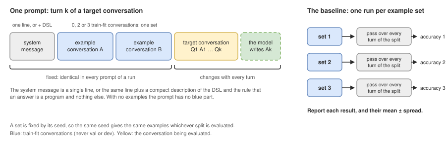

# The untuned baseline {#sec-baseline}

**You will learn:**

- why we measure the untuned model first, and what a *fair* baseline is;
- how a prompt is built from example conversations, and why the examples come in fixed *sets*;
- what is counted when a predicted program is scored.

Fine-tuning will be judged by what it adds to the model we start from, so before training anything we measure
what `Qwen3-4B-Instruct-2507` already does on ConvFinQA. The comparison is only worth making if the baseline is
a fair one. A weak prompt would make any later improvement look bigger than it is. So the untuned model gets the
best help we can give it **without changing its weights**: a description of the DSL, and complete example
conversations written into the prompt [@brown2020gpt3].

## What we measure

For every turn of a conversation, the model reads a prompt and writes a program. Our executor runs the program, and
the result is compared with the gold answer: this is **execution accuracy**, and an output that does not run counts as
wrong. The prompt for turn $k$ ends with question $k$, and what comes before it depends on how the earlier answers
are supplied (@sec-formatting):

- with the **gold history**, every earlier answer in the prompt is the dataset's own program, so each turn is scored
  on its own;
- with the **predicted history**, they are the model's own earlier outputs, mistakes included, and errors compound
  from turn to turn. This is the setting a real user would meet, and the one we treat as the headline.

@sec-base-instruct explained why the two differ: teacher forcing, and exposure bias.

## What to expect

The ConvFinQA paper found that an unfamiliar program syntax hurt GPT-3 [@chen2022convfinqa], and in @sec-probing the
untuned model's errors were mostly failures of **format**: prose, or arithmetic in other notations, instead of a
program. So a good part of what the examples and the description can fix is the format. Choosing the right operation
and numbers is the other part, and it is the one we expect fine-tuning to have to teach.

## How the experiment is organised

- **Prompts.** A prompt holds the system message, then the **example set** (complete training conversations, written as
  earlier turns of the chat), then the target conversation up to the current question. The system message is a
  single line, or the same line plus a compact description of the DSL and the rule that an answer is a program and
  nothing else, or that plus a rule against nested calls.
- **Example sets.** Which examples are used changes the result, and an untuned model has no training seed to vary, so
  the examples play that part. An example set is fixed by its seed alone, so the same seed gives the same examples whichever
  data we evaluate on. When the prompt has examples, the reported baseline is run once for each of three sets, and we report each result
  and their spread.
- **Choosing the prompt.** The variants we try (how many examples, with or without the description, and none at all) are
  listed in advance (one more was added after the first results, and is flagged), and the choice between them is made on the **validation** data. The development data are touched
  only for the numbers the book reports, once, with the prompt already chosen.
- **Scoring.** Generation and scoring are separate steps, so the measures can be refined without generating again.
  This chapter uses execution accuracy, and counts how the invalid outputs fail; the other measures are introduced
  later, where they are used.

## The experiment, exactly

### The prompt

@fig-baseline-prompt shows one prompt, and the three runs that the example sets make.

{#fig-baseline-prompt fig-alt="Left: a row of boxes. A grey system message box, two blue example conversation boxes, a yellow box for the target conversation up to question k, and a dashed green box where the model writes answer k. A bracket marks the first three as fixed for the whole run and the yellow box as changing with every turn. Right: three blue boxes for sets 1, 2 and 3, each with an arrow to a box for a pass over every turn of the split, and an arrow to its own accuracy."}

The **system message** has three forms. The plain one is the line the models are trained with, `Answer with a program in the
ConvFinQA DSL.` The second adds a description of the language and the rule that the answer is the program and nothing
else. Its text is fixed now, and is not tuned on the validation data:

```text
Answer with a program in the ConvFinQA DSL, and write nothing else: no explanation and no code block.

A program is a single number, or a list of steps separated by ", ":
    operation(argument, argument)
The operations are add, subtract, multiply, divide, exp and greater (greater gives yes or no).
An argument is one of:
    a number copied from the page, without thousands separators (a percentage keeps its % sign);
    #k, the result of step k, counting steps from 0;
    a constant: const_1 to const_9, const_10, const_100 and so on up to const_1000000000, or const_m1 for -1.
```

The third form, **flat**, was added after the first six variants had been run, because their errors showed a pattern
(see the results below). It is the description plus one rule, with a made-up example of the contrast:

```text
Each step holds exactly one operation, and an argument is never another operation: write every calculation as a step
of its own and refer back to it with #k. For example, write "subtract(5, 3), divide(#0, 3)", never
"divide(subtract(5, 3), 3)".
```

The **examples** are 2 or 3 complete conversations from train-fit, written as earlier turns of the chat, as in
@sec-formatting. A set of examples is built from a seeded shuffle of
train-fit, position by position: a Type I conversation, then a Type II one, then another Type I. A set therefore holds
exactly one Type II conversation, and the two-example prompt (the first two) shows one of each kind; it is a prefix of
the three-example one. The seeds are 0, 1 and 2, fixed in advance, and no two examples, in a set or between sets, come
from the same report page (several conversations are written from one page, so two of them would show the same table
twice). The sets are saved, as lists of conversation ids, so that a run can be checked against them.

### The variants, and the choice {#sec-baseline-rule}

Seven prompts were compared on the validation data. Those with examples use the first example set (seed 0), taking
its first two or three examples as indicated; those with no examples have no set. Each prompt is a single run: the
three sets are kept for the reported runs on the development data, after the prompt is chosen.

| | one-line system message | with the description | description and the flat rule |
|---|---|---|---|
| no examples | `e0p` | `e0d` | |
| 2 examples | `e2p` | `e2d` | |
| 3 examples | `e3p` | `e3d` | `e3f` (added afterwards) |

`e3f` is **post-hoc**: it was thought of after
reading the errors of the six, so it is flagged as such wherever it appears, and the other prompts of its kind (`e0f`,
`e2f`) are not run.

The seven prompts are scored with the **predicted history**, the headline setting. One of them becomes *the* untuned
baseline: the prompt that is run on the development data and that the fine-tuned models are compared with. It is chosen
on the validation data by a rule that was written down before the first six were run, and applied unchanged to the
seventh:

1. find the variant with the highest execution accuracy;
2. keep every variant that it does not clearly beat, that is, whose paired bootstrap interval for the best variant's
   lead includes zero (the best variant itself is always kept);
3. among those, take the one with the fewest examples, and then the plain system message before the description.

Only clear differences count: the rule works on the paired intervals, which are narrower than the intervals of the
accuracies themselves (the table below shows how wide those are).

### The runs that are reported

The chosen variant is then run on the development data, once, after the decisions of the project are frozen. With
examples, that is one run per set (three) and per history mode (two); without examples, one run per history mode. Both
modes are scored on the same predictions of the same prompts, which differ only in how the earlier answers are filled in.

One more prompt is run on the development data whatever the choice: `e0p`, the one-line message with no examples. It
is exactly what the fine-tuned model will be given, so comparing the two shows what the training changed, with the
input held fixed. It plays no part in the choice of the baseline.

@fig-history-rounds shows the difference between the two modes in how the runs are organised.

{#fig-history-rounds fig-alt="Two grids of turn boxes for four conversations with four, two, three and one turns. Left, gold history: all ten boxes are inside one dashed frame, since every turn is independent. Right, predicted history: boxes are grouped in four dashed frames, rounds 1 to 4, one per turn index; arrows join each box to the next turn of the same conversation."}

### Generation

Decoding is greedy and stops at the end-of-turn token or after 96 new tokens, which is well above the longest gold
program (58 tokens). Prompts are run **one at a time**: with prompts this long the model spends its time reading, so
batching gains little, and a prompt's output then cannot depend on which other prompts share its batch (bf16 results
change slightly with the batch). An output that reaches the limit is scored as written. Every prediction is stored with the
conversation id, the turn, the text, the number of tokens and why generation stopped, and scoring reads these files, so
the measures can change without generating again.

### Scoring

The measure is **execution accuracy**: the executor of @sec-dsl runs the output, and the result is compared with the gold
answer. An output that does not run counts as wrong. Alongside it we count the invalid outputs by cause, with the kinds
of @sec-probing, and the ones that write a calculation as a nested call. More measures (how closely the program matches
the gold one, how numbers are written, answers off by a power of ten, accuracy by turn and by conversation type) are
defined in the chapter that evaluates the fine-tuned models, where they are used on every system at once. The stored
predictions are enough to compute them for the baseline without generating again.


## The code

Three artifacts carry the experiment. `example_sets` is light: it draws the sets from the ids of train-fit, and is
saved so that nothing depends on how the random draw behaves in a later version of Python. The two others are
named by the split, the prompt variant, the example-set seed and the history mode. `untuned_{split}_{variant}_{seed}_{mode}`
loads the model and writes one prediction per turn; its development on dev is refused until a `configs/FROZEN` file
exists, which is how the freeze of the data protocol is enforced. `scores_untuned_…` is light: it executes and scores
the predictions.

```{python}
from convfinqa.artifacts import artifact, get


@artifact(
    "untuned_{split}_{variant}_{seed}_{mode}",
    deps=["train_val_split", "eval_turns", "example_sets"],
    files=["configs/baseline.json"],
    heavy=True,
)
def build_untuned(
    out, deps, files, *, split: str, variant: str, seed: int, mode: str
):
    import json
    import time

    from convfinqa.evaluate import (
        load_model, make_generator, require_freeze, run_generation
    )
    from convfinqa.prompts import parse_variant

    require_freeze(split)
    cfg = files["configs/baseline.json"].json()
    n_examples, kind = parse_variant(variant)
    if n_examples == 0 and seed != 0:
        raise ValueError(
            "a variant with no examples has no example set: use seed 0"
        )
    if split == "val":
        convs = list(deps["train_val_split"].jsonl("val.jsonl"))
    elif split == "dev":
        convs = list(deps["eval_turns"].jsonl("dev.jsonl"))
    else:
        raise ValueError(f"split must be 'val' or 'dev', not {split!r}")
    examples = []
    if n_examples:
        wanted = deps["example_sets"].json("sets.json")\
            ["sets"][str(seed)][:n_examples]
        pool = {
            c["id"]: c
            for c in deps["train_val_split"].jsonl("train_fit.jsonl")
        }
        examples = [pool[i] for i in wanted]

    model, tok = load_model(cfg["model"], cfg["memory_cap_gb"])
    generate = make_generator(model, tok, cfg["max_new_tokens"])
    start, done = time.perf_counter(), 0
    with open(out / "predictions.jsonl", "w") as f:
        def sink(row):
            nonlocal done
            f.write(json.dumps({
                k: v for k, v in row.items() if k != "seconds"
            }) + "\n")   # timing is not an output
            f.flush()
            done += 1
            if done % 50 == 0:
                print(
                    f"{done} turns, {time.perf_counter() - start:.0f} s",
                    flush=True
                )

        run_generation(
            convs, generate, system=cfg["system"][kind],
            examples=examples, mode=mode, sink=sink
        )
    print(f"done: {done} turns in {time.perf_counter() - start:.0f} s")


@artifact(
    "scores_untuned_{split}_{variant}_{seed}_{mode}",
    deps=["untuned_{split}_{variant}_{seed}_{mode}", "eval_turns"],
)
def build_scores_untuned(
    out, deps, *, split: str, variant: str, seed: int, mode: str
):
    import json

    from convfinqa.evaluate import score_rows, summarize

    rows = list(
        deps[f"untuned_{split}_{variant}_{seed}_{mode}"]
        .jsonl("predictions.jsonl")
    )
    scores = score_rows(
        rows, list(deps["eval_turns"].jsonl(f"{split}_turns.jsonl"))
    )
    (out / "scores.jsonl").write_text(
        "".join(json.dumps(s) + "\n" for s in scores)
    )
    (out / "summary.json").write_text(
        json.dumps(summarize(scores), indent=2)
    )
```

The sets drawn from the pool, with the size of the prompt each would make (the example conversations alone, before the
target conversation is added):

```{python}
import json

import pandas as pd
from transformers import AutoTokenizer

from convfinqa import data
from convfinqa.formatting import conversation_messages

sets = get("example_sets").json("sets.json")["sets"]
fit = {c["id"]: c for c in get("train_val_split").jsonl("train_fit.jsonl")}
tok = AutoTokenizer.from_pretrained("Qwen/Qwen3-4B-Instruct-2507")
assert len({i for ids in sets.values() for i in ids})\
     == sum(len(ids) for ids in sets.values())   # no shared conversation

def tokens(conv):
    chat = conversation_messages(conv)[1:]
    return len(
        tok(
            tok.apply_chat_template(chat, tokenize=False),
            add_special_tokens=False
        )["input_ids"]
    )

pd.DataFrame([
    {
        "set": seed,
        "position": n + 1,
        "conversation": i,
        "type": data.conversation_type(fit[i]),
        "turns": len(data.turns(fit[i])),
        "tokens": tokens(fit[i])
    }
    for seed, ids in sets.items() for n, i in enumerate(ids)
]).set_index(["set", "position"])
```

## Choosing the prompt

The seven prompts, on the validation data, with the predicted history. Each accuracy comes with a 95% confidence
interval, found by resampling whole conversations (not single turns, because the turns of one conversation are not
independent). The scores are read from the prediction files.

```{python}
#HEAVY
import pandas as pd

from convfinqa.baseline_report import choose_variant, comparison_rows
from convfinqa.prompts import VARIANTS
from convfinqa.stats import paired_difference

scores = {
    v: list(get(f"scores_untuned_val_{v}_0_pred").jsonl("scores.jsonl"))
    for v in VARIANTS
}
predictions = {
    v: list(get(f"untuned_val_{v}_0_pred").jsonl("predictions.jsonl"))
    for v in VARIANTS
}
rows = {r["variant"]: r for r in comparison_rows(scores, predictions)}
pct = lambda x: f"{100 * x:.1f}%"
pts = lambda x: f"{100 * x:+.1f}"
diff = lambda a, b: paired_difference(scores[a], scores[b])

pd.DataFrame([
    {
        "variant": v + (" (post-hoc)" if v.endswith("f") else ""),
        "execution accuracy":
            f"{pct(r['accuracy'])} [{pct(r['low'])}, {pct(r['high'])}]",
        "invalid outputs": r["invalid"],
        "of which nested": f"{r['nested']} ({r['nested_share']:.0%})",
        "prompt tokens": f"{r['prompt_tokens']:.0f}",
    }
    for v, r in rows.items()
]).set_index("variant")
```

```{python}
#HEAVY
widths = [
    100 * (r["high"] - r["low"])
    for v, r in rows.items()
    if not v.startswith("e0")
]

# the intervals of the accuracies are wide, in the same range
# for every prompt with examples
assert max(widths) < 10
```

With examples, the confidence interval of each accuracy is `{python} f"{min(widths):.0f}"` to
`{python} f"{max(widths):.0f}"` percentage points wide, so two prompts whose accuracies differ by a point or two cannot be
told apart from the two intervals alone. The comparison between prompts is *paired* (both are scored on the same
conversations), which is why it can resolve smaller differences, as the rule of @sec-baseline-rule does.

The rule defined in @sec-baseline-rule is applied in code, not by eye:

```{python}
#HEAVY
choice = choose_variant(scores)
best, chosen = choice["best"], choice["chosen"]
assert chosen == "e3p"   # the prose below describes this outcome
```

The best accuracy is `{python} best`'s, at `{python} pct(rows[best]["accuracy"])`. @tbl-paired-leads shows its lead over
each other variant, as a difference in accuracy with its paired confidence interval. The variants that it does not
clearly beat (the interval includes zero) are `{python} ", ".join(choice["tied"])`, so the rule picks
**`{python} chosen`**: among equals, the plain message.

```{python}
#| label: tbl-paired-leads
#| tbl-cap: "Lead of the best variant over each other variant, in percentage points of execution accuracy (paired bootstrap, 95% confidence interval). A lead is clear when its interval excludes zero."
#HEAVY
leads = pd.DataFrame([
    {
        "variant": v + (" (post-hoc)" if v.endswith("f") else ""),
        "lead": pts(d["difference"]),
        "95% interval": f"[{pts(d['low'])}, {pts(d['high'])}]",
        "clear": "yes" if d["excludes_zero"] else "no",
    }
    for v, d in choice["leads"].items()
]).set_index("variant")
leads
```

```{python}
#HEAVY
half = [
    100 * (d["high"] - d["low"]) / 2
    for v, d in choice["leads"].items()
    if not v.startswith("e0")
]

# a paired interval is narrower than that of an accuracy
assert max(half) < 4 and min(half) > 1

overlap = [
    v for v, d in choice["leads"].items()
    if d["excludes_zero"] and rows[v]["high"] > rows[best]["low"]
]

# some leads are clear although the two accuracy intervals overlap
assert overlap
```

The paired intervals are narrower than the intervals of the accuracies in the table above: their half-width is
`{python} f"{min(half):.1f}"` to `{python} f"{max(half):.1f}"` points for the prompts with examples. That is why a lead of
a few points can be clear here when the two accuracy intervals overlap.

::: {.callout-note title="Under the hood: why pair, and why resample conversations"}
Two prompts scored on the same turns tend to get the same turns right: the easy ones, both; the hard ones, neither. The
variance of a difference is $\mathrm{Var}(A) + \mathrm{Var}(B) - 2\,\mathrm{Cov}(A, B)$, so this shared
difficulty (a positive covariance) cancels in the *paired* difference. It is narrower than the intervals of the two
accuracies once the correlation exceeds one half (for equally noisy estimates), and narrower than a comparison of
independent estimates for any positive correlation.

The usual paired test, a paired $t$-test (`scipy.stats.ttest_rel`), takes this into account, but it treats every
*turn* as an independent item. Turns of one conversation share a page, the same examples and each other's answers, so
they are not independent, and the test's interval is too narrow. The bootstrap here resamples whole
conversations, which keeps both kinds of correlation. For the two closest prompts of the table above:

```{python}
#HEAVY
from convfinqa.baseline_report import turn_level_paired

per_turn = turn_level_paired(scores["e3p"], scores["e3d"])
per_conversation = diff("e3p", "e3d")
half_conv = (per_conversation["high"] - per_conversation["low"]) / 2

# ignoring the conversations makes the interval too narrow, and here
# changes what it says about zero
assert per_turn["half_width"] < half_conv
assert per_turn["excludes_zero"] and not per_conversation["excludes_zero"]
```

Treating turns as independent gives an interval of ±`{python} f"{100 * per_turn['half_width']:.1f}"` points for the
lead of `e3p` over `e3d` (`{python} pts(per_turn["low"])` to `{python} pts(per_turn["high"])`), which excludes zero. Resampling
conversations gives ±`{python} f"{100 * half_conv:.1f}"` (`{python} pts(per_conversation["low"])` to
`{python} pts(per_conversation["high"])`), which does not. The selection rule uses the second.
:::

### What the variants show

Three things in the table are worth a closer look, and each is checked against the data before the sentence that
states it is allowed to print.

```{python}
#HEAVY
zero_shot = diff("e0d", "e0p")
two = diff("e2d", "e2p")
three = diff("e3d", "e3p")
third_example = diff("e3p", "e2p")

# no examples, one line: it fails
assert rows["e0p"]["accuracy"] < 0.05

assert zero_shot["excludes_zero"] and zero_shot["difference"] > 0

# with examples the description does not help
assert two["difference"] <= 0 and three["difference"] <= 0
assert third_example["excludes_zero"] and third_example["difference"] > 0
```

The asserts in that cell hold, so the three findings can be stated:

1. **Without examples**, the one-line message fails almost completely (`{python} pct(rows["e0p"]["accuracy"])` correct):
   `Qwen3-4B-Instruct-2507` answers in prose or wraps its answer in a code block. The description changes that, to
   `{python} pct(rows["e0d"]["accuracy"])`, because it states what an answer looks like.

2. **With examples**, the description no longer helps: with two examples it is `{python} pts(two["difference"])` points
   against the plain message, and with three `{python} pts(three["difference"])`. The examples already show the format,
   so the description has nothing to add. A third example is worth `{python} pts(third_example["difference"])` points
   over the second.

3. **Nested calls** are the largest group of invalid outputs once there are examples. The DSL writes a calculation as
   flat steps, `subtract(5, 3), divide(#0, 3)`, and a model that has seen other programming languages often writes it
   as one expression, `divide(subtract(5, 3), 3)`, which does not run. The cell below prints three such outputs.

```{python}
#HEAVY
from convfinqa.baseline_report import has_nested_call

example_variants = [v for v in VARIANTS if not v.startswith("e0")]

# most invalid outputs nest
assert all(rows[v]["nested_share"] > 0.5 for v in example_variants)

# and the description makes it worse
assert rows["e3d"]["nested_share"] > rows["e3p"]["nested_share"]

invalid = {
    (s["id"], s["turn"])
    for s in scores["e3p"]
    if s["kind"] not in {
        "correct", "wrong_operations", "wrong_numbers", "wrong_answer"
    }
}

shown = sorted(
    (
        r for r in predictions["e3p"]
        if (r["id"], r["turn"]) in invalid
        and has_nested_call(r["output"])
    ),
    key=lambda r: (r["id"], r["turn"]),
)[:3]
print("\n".join(r["output"] for r in shown))
```

With examples, more than half of the invalid outputs of every prompt nest (`{python} pct(rows["e3p"]["nested_share"])`
for the chosen one), and the description raises that share (`{python} pct(rows["e3d"]["nested_share"])` with three
examples). The description tells the model that an argument is a number, a result `#k` or a constant, and it reads that
as a grammar in which an argument can be an expression.

### Telling the model not to nest

That pattern suggested the obvious fix: instruct the model not to nest in the prompt. The post-hoc
variant `e3f` adds the no-nesting rule (shown with the system messages earlier) to the description. It
is the same as `e3d` in every other respect, so the comparison with it isolates the rule.

```{python}
#HEAVY
flat_vs_d, flat_vs_p = diff("e3f", "e3d"), diff("e3f", "e3p")

# the rule recovers part of the description's cost
assert flat_vs_d["difference"] > 0

# but not clearly more than the plain prompt had
assert not flat_vs_p["excludes_zero"]

# and it does not stop the nesting
assert rows["e3f"]["nested"] > 0.9 * rows["e3d"]["nested"]

assert rows["e3f"]["nested_share"] > 0.5
```

The rule helps a little: `e3f` is `{python} pts(flat_vs_d["difference"])` points over `e3d`
(`{python} pts(flat_vs_d["low"])` to `{python} pts(flat_vs_d["high"])`), as syntax errors and bad numbers fall. But it does
not stop the nesting: `e3f` has `{python} rows["e3f"]["nested"]` invalid outputs that nest, against
`{python} rows["e3d"]["nested"]` for `e3d`, so nested calls are now `{python} f"{rows['e3f']['nested_share']:.0%}"` of
what is left. And it is not clearly better than the plain prompt (`{python} f"{100 * abs(flat_vs_p['difference']):.1f}"` points below it, with an interval
that includes zero).

An instruction in the prompt is a request, and with several programs in front of it the model follows what it has seen
more than what it was told. This is a point about what a prompt can do, and it matters for the question that comes back
when the fine-tuned model is compared with this baseline: how much of the distance to a fine-tuned model can be crossed with a better prompt.
